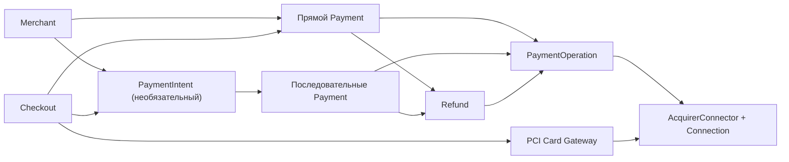

# CONTEXT — восстановленный контекст проекта

**Срез:** 2026-10-09; дополнен owner-допуском и Hello preflight. **Текущая ветка:** `research/tkb-preflight` (первичный аудит: `research/initial-audit`, commit `1c84bb3`). **Исходная ревизия аудита:** `97784b9d69e5f7ce347f84429f69bacc5872cbf0`.

Это производный контекст первой итерации, **не новый журнал согласования**. При расхождении действуют [утверждённые решения](<docs/current/payment-processing-decisions-v1.1.md>) и [NAME-01](<docs/current/payment-naming-conventions-v1.1.md>). [Исходный handoff](<handoff/PROJECT_CONTEXT.md>) сохранён. Итоги и ограничения — в [аудите](<reports/initial-audit.md>), текущая готовность — в [STATUS](<STATUS.md>).

## 1. Роль, полномочия и порядок работы

- Заказчик принимает продуктовые/бизнес-решения, выбирает правовую и расчётную модель, предоставляет допуски. Аналитик самостоятельно исследует и предлагает API/архитектуру, проверяет технические гипотезы и сохраняет свидетельства. Стек, БД и число сервисов не следует выдавать за бизнес-решения.
- Соблюдать [AGENTS](<AGENTS.md>) и [протокол экспериментов](<handoff/EXECUTION_PROTOCOL.md>). История не отменяет current; молчание не означает согласования. Спорные изменения оформляются RFC и предъявляются заказчику.
- На момент первичного аудита были разрешены только анализ и локальная статическая проверка. **После аудита заказчик явно разрешил sandbox, включая финансовые тесты**, указал существующий Postman environment, предоставил test-only карту и разрешил самостоятельное исследование. Также отдельно разрешены хранение именно test-only карточного fixture в коде/Git и тестовое исключение CA-проверки. Актуальный scope/фактические наблюдения — [preflight](<reports/results/tkb/2026-10-09-preflight.md>). Production, реальные карточные данные/секреты, обход 3DS и неизвестные денежные повторы этим не разрешены. Наличие endpoint не доказывает bank-terminal rights.
- Не переносить PAN/CVV, секреты, полные запросы/ответы и рабочие токены в Git, общие журналы, отчёты и контекст модели. Оригиналы банка/референсные исходники не публиковать; лицензии и право переиспользования проверить отдельно.

## 2. Продукт и границы

Независимый мультибанковский процессинг: единый merchant API, кабинет и дистанционное подключение для **ЮЛ, ИП и физлиц на НПД**, принимающих оплату за **собственные** товары/услуги. Это не marketplace/split и не система свободных выплат третьим лицам. Карты и СБП; кошельки — дальнейшее расширение. Нужны оплаты/статус, холды/capture, полные/частичные возвраты, сохранённые карты и последующие списания. Цель **≥100 RPS публичного API**, не каждого банковского подключения. Основание: [границы продукта](<docs/current/payment-processing-decisions-v1.1.md#L17-L28>).

Из первого чата важно сохранить:

1. Правовую модель и участие компании в перечислении выручки **не выбрали**. Прямые расчёты банка с продавцом — рабочая гипотеза, не согласованное решение ([страницы 11–22](<../1st-chat.pdf#page=11>)). Исторические тарифные примеры и выводы о законах не перепроверены и не заменяют юридическое заключение.
2. Продуктовое пожелание — самостоятельное онлайн-подключение через кабинет, сотрудники только в исключениях. Это не доказательство наличия API онбординга у банка ([страница 30](<../1st-chat.pdf#page=30>)).
3. Первоначальный категоричный юридический вывод агента о НПД позже исправлен им самим: допустимость идентификации/подключения выяснять с юристом и банком, не объявлять автоматически запрещённой или разрешённой ([страница 32](<../1st-chat.pdf#page=32>)).
4. Гибрид Payment + необязательный Intent предложил **заказчик**: сильным merchant-командам нужен прямой режим, остальным — управляемая покупка ([страницы 59–64](<../1st-chat.pdf#page=59>)).
5. Redirect-only пилот не выполняет требование своей карточной формы: заказчик явно исправил интерпретацию агента ([страницы 127–128](<../1st-chat.pdf#page=127>)).

## 3. Согласованные BR и NAME-01

Все перечисленные нормы утверждены 2026-10-09; их банковская реализуемость оценивается отдельно.

| Решение | Действующая семантика | Источник / историческое согласование |
|---|---|---|
| BR-01 | Payment самостоятелен и окончателен; следующий платёж — новый Payment. Intent опционален, дети последовательны, создаются процессингом только по действию покупателя; активный/unknown ребёнок запрещает новую оплату. Прямой Payment задним числом не присоединяется. Connector не управляет Intent. | [Журнал:32–46](<docs/current/payment-processing-decisions-v1.1.md#L32-L46>); [с.64](<../1st-chat.pdf#page=64>) |
| BR-02 | Окно, лимит, отмена и риск блокируют новые попытки. failed/expired/canceled допустимы только после исключения списания, активного холда и неизвестного эффекта. Начатая оплата может завершиться поздним успехом. | [Журнал:48–65](<docs/current/payment-processing-decisions-v1.1.md#L48-L65>); [с.74](<../1st-chat.pdf#page=74>) |
| BR-02.1 | 30 минут по умолчанию, настройка 5 минут–24 часа; 5 попыток, настройка 1–10. Неизменный снимок при создании. Покупателю нейтральная причина риска, merchant — категория/ссылка поддержки, уполномоченным сотрудникам — детали с аудитом. Срок банка независим. | [Журнал:67–91](<docs/current/payment-processing-decisions-v1.1.md#L67-L91>); [с.79](<../1st-chat.pdf#page=79>) |
| BR-03.1 | В v1 один **успешный окончательный** полный или частичный capture на холд. Multicapture — отдельно. Доказанно неисполненная команда не равна успешному capture; unknown блокирует новый. Остаток освобождён только по банковскому доказательству. | [Журнал:93–107](<docs/current/payment-processing-decisions-v1.1.md#L93-L107>); [с.88](<../1st-chat.pdf#page=88>) |
| BR-03.2 | Частичный финальный capture ребёнка требует явного согласия merchant уменьшить сумму Intent. После доказанного результата сохраняются исходная/final/paid суммы, Intent succeeded; добор внутри него запрещён. Освобождение остатка не refund. | [Журнал:109–125](<docs/current/payment-processing-decisions-v1.1.md#L109-L125>); [с.93](<../1st-chat.pdf#page=93>) |
| BR-04 | Refund succeeded только по достаточному доказательству **исполнения**, не accepted/HTTP 200/202. Видимость денег у покупателя не обязательна. Unknown/pending сохраняют резерв; доказанный отказ его снимает; доказанное позднее обращение — reversed и компенсирующий факт. Payment/Intent остаются succeeded после возврата. | [Журнал:138–156](<docs/current/payment-processing-decisions-v1.1.md#L138-L156>); [с.103](<../1st-chat.pdf#page=103>) |
| BR-05 | Поздний успех после запроса cancel, но до доказанного canceled: оплата succeeded, отмена не исполнена, специальное уведомление merchant. **Автовозврата в v1 нет**. После уже доказанного canceled поздний успех — инцидент, не штатный откат. | [Журнал:158–176](<docs/current/payment-processing-decisions-v1.1.md#L158-L176>); [с.111](<../1st-chat.pdf#page=111>) |
| BR-06 | Целые минимальные единицы, в v1 только RUB/копейки; одна неизменная currency ресурса. Создание amount + currency; ответы Payment/Intent — amounts; одиночные Refund/Operation — amount. Комиссии и выплаты отдельно, без float/конвертации. | [Журнал:178–195](<docs/current/payment-processing-decisions-v1.1.md#L178-L195>); [с.115](<../1st-chat.pdf#page=115>) |
| BR-07 | Свой **реальный ввод карты** через выделенный PCI-контур и разрешённый direct/WOF API хотя бы одного банка + банковская hosted-форма как fallback. ACS внешнего эмитента допустим. Один accent, общий Checkout карты/СБП. Hosted fields — отдельное техническое решение, не молчаливая замена. | [Журнал:197–215](<docs/current/payment-processing-decisions-v1.1.md#L197-L215>); [с.116,127](<../1st-chat.pdf#page=127>) |
| NAME-01 | Наши поля API/SPI/событий/БД: одно смысловое слово где достаточно, максимум два; snake_case. Полная семантика в описании. Внешние банковские имена сохраняются на wire. Проверка сегментов не проверяет смысл. | [Норма:3–14](<docs/current/payment-naming-conventions-v1.1.md#L3-L14>); [с.93–94](<../1st-chat.pdf#page=93>) |

BR-03 в текущем журнале раскрыт как **BR-03.1 и BR-03.2**, BR-02 дополнен BR-02.1. Старые номера вопросов в начале чата нельзя механически сопоставлять с этими окончательными решениями.

## 4. Восстановленная предметная модель

### Payment

Одна оплата, один выбранный маршрут/банковская сессия. `intent_id=null` для прямой оплаты; у ребёнка связь неизменна. Нормальные финальные состояния не переоткрываются. `requires_payment_method` означает **первичный** выбор, не повтор отказанной оплаты. Статусы проекта: requires_payment_method, requires_confirmation, requires_action, processing, requires_capture, succeeded, failed, canceled, expired. `unknown` финансовой операции наружу представлен processing. Возврат не меняет исторический успех. Источник: [lifecycle:26–40,76–127](<docs/current/payment-lifecycle-spec-v0.12.md#L26-L127>).

Денежный снимок `amounts`: requested, authorized, captured, paid, released, refunded, capture_reserved, refund_reserved, capturable, refundable. `paid` не означает перечисление merchant, `released` не получается одной арифметикой. [Денежные правила](<docs/current/payment-lifecycle-spec-v0.12.md#L484-L520>).

### PaymentIntent

Управляемая покупка, не банковская транзакция. Объединяет детей одной суммы/валюты/merchant/заказа. Максимум один неокончательный ребёнок. Итог определяется проверенным результатом детей и политикой закрытия. `last_payment` — последний ребёнок, `paid_payment` — успешный; `payments_count` не равен бюджету отправленных попыток. `attempts.used` в проекте считается с dispatch_started; это техническая детализация, не новая бизнес-норма. `can_confirm` — снимок права, условия повторно проверяются атомарно.

Ответы: `amounts.requested` неизменна, `amounts.final=null` до финального итога, `amounts.paid` — подтверждённая оплата до возвратов. Старые верхнеуровневые amount_final/amount_paid не следует возвращать в wire-контракт. Источники: [корреляция/политика](<docs/current/payment-lifecycle-spec-v0.12.md#L144-L196>), [BR-06:193](<docs/current/payment-processing-decisions-v1.1.md#L193>).

### PaymentOperation и Refund

Operation — отдельная финансовая команда/факт debit, authorize, capture, void, refund, с собственным резервом, идентификаторами и свидетельствами. Внутренние created/submitted/unknown не равны публичным processing/pending/succeeded/failed/reversed. `DispatchIntent` — внутренняя запись подготовки отправки, **не PaymentIntent**. [Операции](<docs/current/payment-lifecycle-spec-v0.12.md#L225-L263>), [разделение статусов](<docs/current/acquirer-connector-contract-v1.1.md#L50-L56>).

Refund — отдельный публичный ресурс конкретного Payment. Один финансовый эффект нельзя учитывать независимо второй раз через Refund и Operation. `refundable=paid-refunded-refund_reserved`; неизвестность не освобождает резерв. Несколько частичных возвратов допустимы лишь по возможностям подключения. Частичное обращение возврата пока направляется на сверку, не изображается фиктивным полным reversed. [Правила возвратов](<docs/current/payment-lifecycle-spec-v0.12.md#L317-L386>).

### Checkout и соединители

Checkout — UI и ограниченная браузерная сессия к Payment/Intent, **не новая финансовая сущность**. `checkout.url` — наша страница, может существовать до первого ребёнка; `next_action` — последующий банковский шаг (hosted/ACS, QR, SDK). Ссылки и browser return не доказывают оплату. Наш merchant bearer и банковские credentials не поступают браузеру. [Дизайн Checkout](<docs/current/payment-checkout-design-v0.2.md#L32-L87>).

Connector знает конкретный Payment/Operation/Connection, переводит wire-протокол/денежные единицы, проверяет события, получает состояние/реестры, возвращает нормализованный результат со свидетельством. Core владеет Intent, резервами, дедупликацией, финансовым журналом и outbox. Интерфейс описывает getCapabilities, submit, lookup, verifyAndParseNotification и опционально getSettlementRecords; это **не реализация**. `supported/unsupported/unknown` определяется для конкретного подключения и операции. Отсутствующая/unknown возможность не рекламируется. [SPI](<docs/current/acquirer-connector-v0.6.ts#L45-L90>), [методы](<docs/current/acquirer-connector-v0.6.ts#L230-L244>).

## 5. Три разных повтора и границы гарантии

1. Merchant API retry с тем же Idempotency-Key/телом — тот же исходный ресурс/ответ, не новая оплата. Иное тело — конфликт.
2. Новая оплата внутри Intent — новый ребёнок по действию покупателя после доказанного отсутствия эффекта прежнего.
3. Повтор банковской отправки — только при подтверждённой идемпотентности **именно метода/reference/срока** либо доказанной неотправке. Новый локальный ID или `ExtId` сам по себе не разрешает повтор.

Источник: [первый чат, с.55](<../1st-chat.pdf#page=55>), [восстановление](<docs/current/acquirer-connector-contract-v1.1.md#L116-L140>). Локальная транзакция не обеспечивает exactly-once вызов внешнего банка. Защита Intent не гарантирует уникальную оплату `order_id` между разными Intent/прямыми Payment и не предотвращает физически противоречивый поздний исход банка. [Границы гарантии](<docs/current/payment-lifecycle-spec-v0.12.md#L144-L153>).

## 6. Источники банка и старых форм

[external-docs](<external-docs/>) содержит 8 MHTML-документов с расширением .doc и Postman collection/environment. [reference-code](<../reference-code/>) содержит собственную старую форму, 3DS frontend и форму ТКБ. Они исследованы статически, не запущены. Банковские документы/примеры показывают существование методов, не права конкретного терминала, безопасность повторов или исполнение платежа. [Банковский и кодовый аудит](<reports/results/audit/bank-reference-review.md>).

Важная свежесть источников: название коллекции указывает срез 11.04.2025, а документ истории шлюза содержит изменения до 13.07.2026. Текущий wire-контракт требует сверки casing/методов/3DS с банком; нельзя слепо генерировать клиент из старых примеров. Профиль ТКБ помечен documentary_only_not_tested, возможности unknown: [профиль](<docs/current/tkb-connector-profile-v0.2.yaml>).

## 7. Что не считать решённым

Правовая/расчётная модель, договорная схема банков/онбординга НПД, PCI scope/attestation, актуальный протокол WOF/3DS2, критерии финальности и остатка холда, operation-level idempotency/correlation, routing policy, SDK/embed, retention/SLA, физическая БД/стек, исполняемый core и 100 RPS. Открытые продуктовые решения — в [вопросах](<reports/open-questions.md>); инженерные действия и безопасный порядок — в [плане](<tasks/next-steps.md>).

## 8. Охват и достоверность восстановленного контекста

Первый чат: **139/139 физических страниц текстового слоя** прочитаны постранично, с отдельными карточками [1–50](<reports/results/audit/chat-pages-1-50.md>), [51–100](<reports/results/audit/chat-pages-51-100.md>), [101–139](<reports/results/audit/chat-pages-101-139.md>). PDF имеет фрагментированные слова/таблицы; визуальное чтение недоступно текущей модели. Точное содержание отдельных визуальных вставок не подтверждено — см. ограничения источникового аудита. Все существенные нормы дополнительно сверены с журналом. История спецификаций: [обзор](<reports/results/audit/history-review.md>), [API/YAML](<reports/results/audit/history-yaml-review.md>). Статические проверки и ограничения их покрытия — [отдельный отчёт](<reports/results/audit/static-checks.md>).
