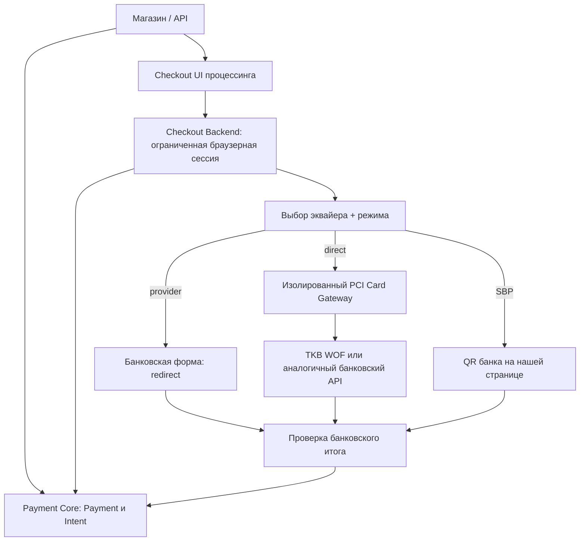

# Платёжная форма процессинга — спецификация BR-07 v0.2

**Дата:** 2026-10-09.  
**Статус:** BR-07 согласовано 2026-10-09; технические решения, права WOF банка и PCI-готовность требуют подтверждения.  
**Контекст:** BR-01—BR-06, NAME-01; `payment-processing-architecture-v0.9.md`, `payment-api-v0.10.openapi.yaml`, `acquirer-connector-v0.5.ts`.  
**ИСТОЧНИКИ:** предоставленная коллекция `TKBPAY-v11042025.postman_collection.json` и документация ТКБ; PCI SSC FAQ 1578, 1579, 1291, 1319; EMVCo 3DS browser challenge. Никаких запросов к банку не выполнялось.

## 1. Утверждённый продуктовый контракт BR-07 [Б]

1. **Своя форма означает свой ввод карты.** Покупатель вводит номер карты, срок действия и CVC/CVV **в нашей платёжной форме**. Это существенный UX/продуктовый критерий, а не просто своя страница с редиректом на банковский ввод карты.
2. Для банка с разрешённым API оплаты без банковской формы (`direct`/WOF) по умолчанию применяется **наш** интерфейс карты; банковские реквизиты передаются только через специально защищённый контур.
3. Для банка, не предоставляющего подходящий API, поддерживается **форма банка** (`provider`); это корректный fallback для такого банка, но не подмена обязательной собственной формы для всего продукта.
4. Одна система: `Payment`, `PaymentIntent`, `Refund`, общая история, события и правила BR-01—BR-06 не зависят от владельца UI.
5. Наша форма имеет минималистичный дизайн, переиспользующий визуальные решения `pyment-form-main`: один изменяемый акцентный цвет мерчанта; остальные цвета и состояния вычисляются дизайн-системой.
6. Браузерный 3DS challenge у ACS банка-эмитента (аутентификация) не равен переходу на банковскую форму **ввода реквизитов**; после него возвращаемся в наш Checkout.

**Критерий выполнения BR-07:** продемонстрирована рабочая оплата картой с вводом данных через нашу форму и разрешённый direct API хотя бы одного эквайера (первый кандидат — ТКБ), включая 3DS и проверенное подтверждение результата. Дополнительно реализован fallback на форму банка. Режим «наш экран выбора + ввод карты на сайте банка» без direct-функции не означает выполненного BR-07, даже если может быть выпущен как ограниченный технический пилот.

**Безопасность не отменяет требование:** PAN/CVV не передаются в обычное платёжное ядро и Merchant API. Реализация WOF требует достаточной PCI DSS готовности, подтверждённых банковских прав и проверенной последовательности 3DS. Допускаются другие защищённые технологии ввода реквизитов только если они соответствуют утверждённому UX и отдельно технически согласованы.

## 2. Два режима интеграции с банком [П]

| Режим | Банковский API | Что видит покупатель | Работа с PAN/CVV | Условие использования |
|---|---|---|---|---|
| `direct` | Методы банка для формы продавца (WOF/direct card) | Платёжная форма процессинга, при необходимости 3DS от ACS | Через специально защищённый PCI-контур процессинга; **не через merchant API/core** | Документально разрешено банком + PCI DSS + тесты 3DS |
| `provider` | Создание платежа со ссылкой на форму банка | Переходит на **банковскую форму ввода карты**; возвращается через наш результат | Банк, без получения PAN/CVV процессингом | Банк допускает hosted flow; fallback только там, где direct недоступен |

Дополнительный вариант, **не подтверждён ТКБ**: `fields`/hosted-fields или банковская токенизация, при которых интерфейс вокруг полей наш, а сами поля/данные обслуживает сертифицированный провайдер. Не считать его поддерживаемым, пока нет SDK/документации.

**Важно:** собственная страница с переходом на банк НЕ равна собственной карточной форме для BR-07. Банковские hosted fields могут обеспечивать свой внешний UX при меньшей области PCI, но это отдельный возможный способ реализации: считать его удовлетворяющим BR-07 только после проверки/согласования, а не автоматически.

## 3. Компоненты системы [П]



- `Checkout UI`: внешний вид, ввод заказа/метода оплаты, мобильная адаптация, QR, индикатор 3DS, результат; может быть полностью собственным интерфейсом.
- `Checkout Backend`: узкодействующий непривилегированный браузерный доступ, привязанный к существующему `Payment` или `PaymentIntent`. Никогда не передаёт браузеру секреты банка или merchant bearer token.
- `Payment Core`: сумма, лимиты, статусы, маршрутизация, идемпотентность, неизменные финансовые факты; **никогда не получает PAN/CVV** в доменной модели, брокере событий, БД или логах.
- `PCI Card Gateway`: отдельный защищённый сервис/контур работы с карточными реквизитами и банковскими WOF API; границы и проверку PCI DSS определить с QSA и банком. Одноразовые ссылки на ввод карты могут действовать недолго; реальные значения TTL — техническая политика, не новая бизнес-договорённость.
- `AcquirerConnector`: банковская специфика запроса, 3DS, статусы, подтверждение возможностей терминала. При работе с чувствительными данными исполнитель такого соединителя входит в PCI scope либо использует безопасный интерфейс PCI Card Gateway.
- `Checkout UI` размещается на нашем домене; продавец получает ссылку и при желании может встраивать окно через документированный способ, не включая PAN/CVV в своё приложение.

## 4. Два пользовательских сценария [П]

### 4.1. Наш интерфейс + банковский API `direct`

1. Магазин создаёт `Payment` или `PaymentIntent` обычным API; получает `checkout.url` (проект дополнения).
2. Покупатель открывает **нашу** страницу, выбирает оплату картой.
3. Ядро выбирает доступное банковское подключение и проверяет `direct` для выбранного терминала **и** PCI readiness платформы; фиксирует маршрут до потенциальной отправки.
4. Карточные данные вводятся и обрабатываются внутри изолированного PCI-контура; публичный merchant API и payment core их не получают. При необходимости форма работает через безопасно предоставленный банковский токен/поля, если банк документировал их.
5. Банковский соединитель выполняет нужную цепочку 3DS: frictionless либо challenge; challenge проводит ACS банка-эмитента в контролируемом окне/переадресации, не нашим самодельным вводом кода.
6. После 3DS выполняется завершение оплаты/авторизации по документации провайдера.
7. Статусы `Payment` и `PaymentIntent` обновляются только по достоверным банковским фактам, а не по `return_url`.

### 4.2. Наш интерфейс + банковская страница `provider`

1. Магазин создаёт ресурс и получает ссылку **на наш checkout**.
2. Покупатель выбирает карту; соединитель получает банковский `redirect.url` (при наличии подтверждённого маршрута).
3. Наш checkout переводит покупателя на форму банка; карточные данные собирает банк.
4. Покупатель возвращается на нашу страницу результата. Возврат браузера не считается доказательством оплаты.
5. Подписанное событие или допустимый запрос состояния устанавливают окончательный статус.

**SBP:** на нашей форме показываем QR/ссылку, полученную через банк; ввод PAN/CVV и банковская карточная форма не нужны. Технические детали QR конкретного банка регулируются его возможностями.

## 5. Выбор маршрута и fallback [П]

- Выбор состоит из **пары** `(банк, режим формы)`, а не только банка.
- Согласованное требование: `platform` в приоритете, `provider` — fallback, если direct-режим недоступен или не разрешён на данном банковском терминале / продукт ещё не прошёл PCI readiness.
- Нельзя объявлять `direct` доступным по одному наличию endpoint в Postman: должна быть подтверждённая способность `supported` для конкретного `merchant_connection_id`, способа оплаты и терминала.
- Переход с direct на provider допустим **до отправки финансовой операции** либо после доказанного отсутствия её отправки/эффекта. При `unknown` нельзя молча переотправить деньги, выбрать другой банк или создать второй активный `Payment`.
- Если после неуспешной попытки покупатель хочет использовать другую карту, в `PaymentIntent` создаётся **новый дочерний Payment** по BR-01. Для прямого `Payment` требуется отдельный новый платёж.
- Не делать автоматических повторов или автоматического перехода на другой банк после финансового отказа.

## 6. TKB PAY: документированные методы [И]

По исходной Postman-коллекции (не по исполненным тестам):

| Шаг/функция | Метод ТКБ | URI |
|---|---|---|
| Hosted карточная оплата | `RegisterOrderFromUnregisteredCard` | `/api/v1/card/unregistered/debit` |
| Своя карточная форма | `RegisterOrderFromUnregisteredCardWOF` | `/api/v1/card/unregistered/debit/wof` |
| Завершение WOF (один из сценариев 3DS) | `RegisterOrderFromCardFinish` | `/api/v1/card/unregistered/debit/wof/finish` |
| Проверка 3DS 2.0 | `Check3ds` | `/api/v1/card/unregistered/debit/3ds2check/storecard` |
| Аутентификация 3DS 2.0 | `Authenticate3ds` | `/api/v1/card/unregistered/debit/3ds2Authenticate` |
| Проверка результата 3DS 2.0 | `Validate3ds` | `/api/v1/card/unregistered/debit/3ds2Validate` |
| Завершение WOF 3DS 2.0 | `DebitUnregisteredCard3ds2WofFinish` | `/api/v1/card/unregistered/debit/3ds2/wof/finish` |
| Холд с реквизитами | `Hold` | `/api/v1/card/unregistered/hold/register` |
| Завершение холда | `HoldFinish` | `/api/v1/card/unregistered/hold/register/finish` |
| Холд с 3DS 2.0 | `Hold3Ds2.0` | `/api/v1/card/unregistered/hold/register/3ds2/finish` |
| Привязка через нашу форму | `BindCardUniversal WOF` | `/api/v2/card/unregistered/bind/wof` |

**Оговорки:** названия и пути подтверждены Postman, но ответы 3DS для sandbox почти не представлены; точный порядок вызовов, флоу tokenization, право нашего терминала, применимость к СБП и безопасность клиента — верифицировать с ТКБ. В примере `Authenticate3ds`/`Validate3ds` некоторые запросы содержат явно заданный production host: **не переносить его автоматически в тестовый контур и не делать live-запросов по примеру**. Метод `/wof/no3ds` также присутствует в коллекции, но не предлагается как маршрут по умолчанию — нужна специальная оценка риска и право банка.

## 7. PCI DSS и граница безопасности [П / внешние нормы]

**Граница:** WOF ТКБ принимает `CardInfo` с `CardNumber`, сроком действия и `CVV`. Следовательно, простой веб-интерфейс, пересылающий эти данные через наш обычный backend, меняет область PCI DSS и модель угроз. Сам endpoint не избавляет от сертификации.

- Наша компания выступает поставщиком платёжного сервиса. Оценка PCI DSS должна определяться **как для service provider**, а не через упрощённые merchant SAQ A/SAQ A-EP. PCI SSC FAQ 1578: https://www.pcisecuritystandards.org/faqs/1578/ . Параметры подтверждения соответствия, уровень и договорные обязательства — согласовать с банком, платёжными системами и QSA.
- Для merchant-сайтов hosted iframe/direct post модели имеют разную область PCI scope (PCI SSC FAQ 1291): https://www.pcisecuritystandards.org/faqs/1291/ . Это сравнительная иллюстрация, а не разрешение нашему PSP использовать SAQ A.
- CVV не хранится **после авторизации даже зашифрованным**; не передавать его в логи, трассировки, аналитику, `jsonb`, клиентские ошибки, общие события, debug/request dumps. Источник: https://www.pcisecuritystandards.org/faqs/1319/ .
- Web checkout: управление сторонними скриптами, проверка целостности, CSP, изменение страницы, защита от e-skimming. PCI SSC, март 2025: https://blog.pcisecuritystandards.org/new-information-supplement-payment-page-security-and-preventing-e-skimming .
- 3DS challenge исполняется средствами эмитента/ACS, а не нашим полем для OTP; используем документированные шаги протокола. EMVCo: https://www.emvco.com/dynamic/emv-3-d-secure-whitepaper-v2/challenge-flow/business-overview/ .
- Секреты HMAC ТКБ — только на сервере внутри защищённого контура, ни в JS/browser, ни в URL. Коллекция Postman содержит диагностические сценарии, которые могут логировать секреты; их нельзя переносить в приложение.
- Данные карт не допускаются в публичный `PaymentMethodRequest`, `PaymentIntent`, банковские provider-extensions и metadata. Сохранённые методы оплаты — только токены/внутренние ссылки на защищённые токены; переносимость токенов разных банков не гарантируется.

**Пока PCI readiness отсутствует, прямой WOF-режим нельзя включать в промышленный контур.** Пилот с нашей страницей СБП и перенаправлением на банковский ввод карты допустим как технически ограниченный этап, **но не закрывает BR-07 и не может называться собственной карточной формой**.

## 8. Предложение к публичному API (НЕ согласовано как контракт) [П]

Собственный ввод карты выполняется только в защищённом UI/PCI-контуре, не в публичном merchant API. Добавить необязательный объект `checkout` в ответы `Payment` и `PaymentIntent`:

```json
{
  "checkout": {
    "url": "https://checkout.example.invalid/c/opaque-reference"
  }
}
```

`checkout.url` — **наша** страница, не банковская, доступ через короткоживущий и ограниченный checkout-сеанс. `PaymentIntent` может иметь ссылку до создания первого дочернего `Payment` — необходимое отличие от существующего `next_action`. Внутренний браузерный checkout API может вызывать `confirm` по действию покупателя без доступа к merchant bearer token.

В `GET /v1/capabilities` добавить `methods[].forms` с признаком доступности `platform` и `provider` для конкретной торговой точки, без выдачи неподтверждённых возможностей. Режим настраивается в маршрутизации, а не определяется видом `Payment`/`PaymentIntent`.

Действующий `next_action` остаётся для следующего шага *банка* (`redirect`, `display_qr`, `sdk_action`). Банк не имеет доступа к объекту `PaymentIntent` и не управляет checkout-сеансом.

## 9. Проверочные сценарии [П]

- Критерий продукта: карта вводится на нашей форме и оплачивается через разрешённый direct/WOF API; не совершается redirect на банковскую форму ввода карты; PAN/CVV не попадают в `Payment Core` и merchant API.
- Для банка только с hosted page — наш Checkout выбирает метод и перенаправляет на его HTTPS-страницу; это fallback конкретного банка, а не выполнение собственного ввода карты для всего продукта.
- 3DS frictionless и 3DS challenge работают в обоих режимах, результат после возвращения браузера считается `pending/processing`, пока банк не подтвердил.
- Hosted-mode блокируется на запрещённом/неподтверждённом терминале.
- Direct-mode отключён, когда PCI readiness=false, даже если профиль банка документирует WOF.
- Подмена/повтор браузерного токена checkout не создаёт второй платеж; нет доступа к чужому merchant/intent/payment.
- При `unknown` fallback не создаёт дополнительную финансовую операцию.
- Истёкший `PaymentIntent` не начинает оплату, даже если checkout-ссылка ещё открыта.
- Результаты браузерного возврата не являются источником истины.
- CVV/PAN отсутствуют в БД, логах, брокерах, webhooks, analytics, provider-data JSON и трассировке.
- Встроенные представления поддерживаются только там, где их допускают безопасность и политика банка; не предполагать iframe для банковской формы по умолчанию.

## 10. Открытые условия для технического утверждения [О]

1. На каком основании компания будет обрабатывать PAN/CVV и какие требования/сроки PCI DSS предъявят эквайеры? Кто владелец PCI-проекта/QSA?
2. Разрешено ли ТКБ использовать каждый WOF endpoint на нашем merchant/terminal и нужны ли дополнительные соглашения, whitelisting, 3DS certification?
3. Есть ли в ТКБ hosted fields / client-side tokenization / JS SDK, позволяющие собственный внешний вид **без** непосредственного сбора PAN нашим сервером?
4. Точный 3DS2 ECOM WOF протокол: запрос/ответ Check, Authenticate, Validate, Finish; браузерный шаг ACS; возвраты/ошибки; тестовые карты и сценарии.
5. Какую долю старого фронтенда можно использовать после проверки безопасности? Исходники не представлены для ревью.
6. Какие способы встраивания нашей формы в магазин доступны на первом этапе (только redirect / popup / SDK / iframe)? Никакой из них не должен раскрывать merchant credentials.
7. Какой банковский режим выбирается, если одновременно доступны direct и provider, но у них различаются тарифы/3DS/отказы? Утверждать совместно с политикой маршрутизации.

**План реализации:** разрабатывать Checkout и защищённый card-entry/WOF контур совместно. Без подтверждённых PCI-условий и разрешения эквайера прямую обработку PAN/CVV не включать. Ограниченный пилот QR + bank-hosted возможен, но полное выполнение BR-07 требует собственной формы ввода карты и банковского fallback. Проектный объём и сроки пилота — отдельное планирование, не подмена бизнес-требования.
