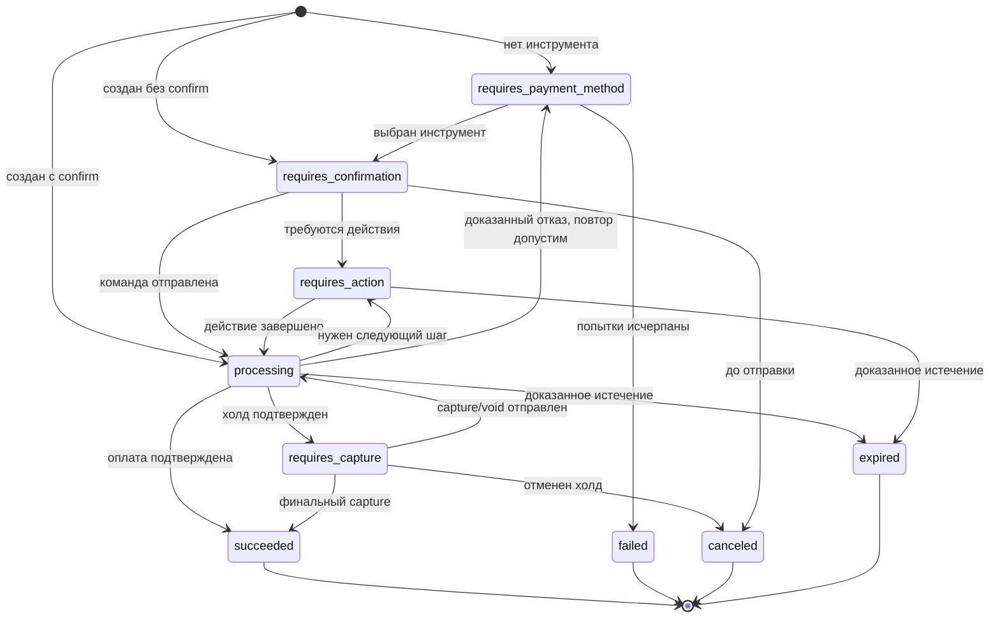
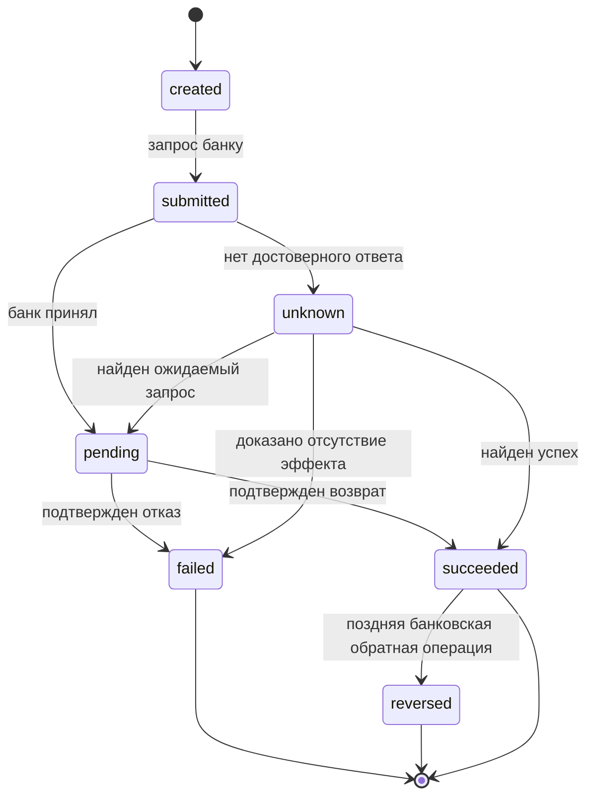
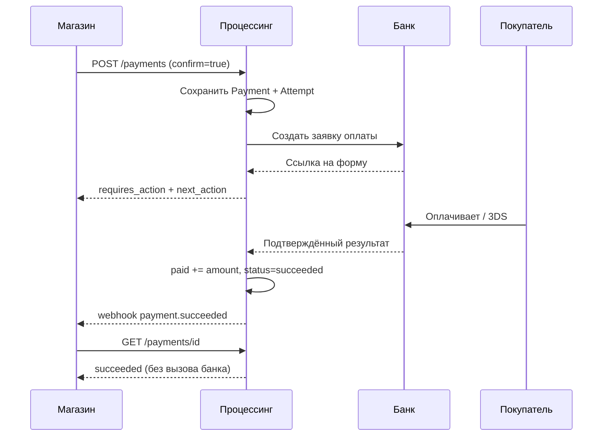
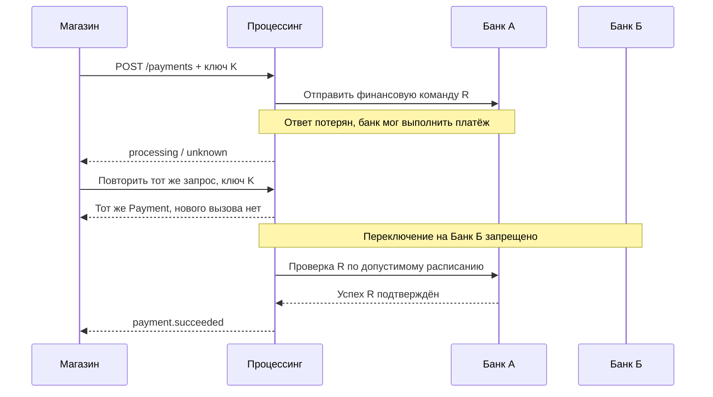

# Платёжный процессинг — спецификация жизненного цикла платежей v0.2

**Дата:** 2026-10-09  
**Статус:** проект системного анализа; не согласованный контракт и не банковская спецификация.  
**Связанные документы:** `payment-processing-architecture-v0.1.md`, `payment-api-v0.1.openapi.yaml`.  
**Область:** приём оплаты картами, СБП и в перспективе кошельками; банки-эквайеры подключаются через независимые соединители; расчёты с продавцами напрямую через банк — текущая гипотеза.

> **Отделение фактов от предложений.** `[Б]` — решение заказчика, `[И]` — сведения из предоставленных материалов или официальных документов внешних продуктов, `[П]` — предлагаемое правило процессинга, требующее утверждения. Отсутствие у ТКБ описания отдельного действия или кода **не доказывает**, что банк его не поддерживает.
>
> **Безопасность.** Здесь нет реальных ключей, адресов тестового стенда, номеров карт и секретов из Postman. Запросы к тестовому контуру не выполнялись.

## 1. Цель и границы

### 1.1. Входные решения заказчика [Б]

- Начальные клиенты: юридические лица, ИП и физические лица на НПД, которые продают **собственные** товары и услуги.
- Единое дистанционное подключение в нашем кабинете, без самостоятельной интеграции продавца с банками.
- Публичный независимый API: создание/статус оплаты, полный/частичный возврат, холдирование, подтверждение, привязка карт, повторные списания; карты, СБП, последующее расширение на кошельки.
- Несколько банков с разными протоколами; первый исследуемый стенд — ТКБ.
- Ориентир нагрузки не менее 100 RPS публичного интерфейса; это не подтверждённый лимит банка.

### 1.2. Сейчас вне объёма [Б/П]

Распределение одного платежа между несколькими получателями, массовые выплаты и хранение денежных остатков пользователей; самостоятельная НКО; пользовательский ввод PAN/CVV в нашем API; гарантированная переносимость банковского токена карты; обещание множественных частичных подтверждений холда в первом выпуске.

### 1.3. Принцип модели [П]

**Платёж ≠ попытка оплаты ≠ финансовая операция ≠ банковское перечисление продавцу.**

- `Payment` — одно намерение получить оплату за конкретную покупку. Имеет один положительный успешный результат оплаты, даже если предварительно было несколько неуспешных попыток.
- `PaymentAttempt` — один выбранный маршрут/банк/инструмент и его результат. Один `Payment` может иметь несколько *последовательных* попыток. Две финансово неопределённые попытки параллельно **запрещены**.
- `PaymentOperation` — отдельная команда и факт `authorization`, `capture`, `void`, `refund`, в том числе её неопределённый исход.
- `Refund` — публичный ресурс возврата, связанный с финансовой операцией; возможны несколько возвратов одного платежа.
- `SettlementRecord` — расчётная информация о зачислении продавцу; не определяет `Payment.status`.

## 2. Основания для модели

| Источник | Что достоверно следует из источника | Ограничение применения |
|---|---|---|
| TKB PAY: `Операции+платежного+шлюза.doc`, коллекция Postman | Есть операции оплаты новой/сохранённой картой, `Hold`, `HoldConfirm`, `HoldReversal`, `Refund`, `Reverse`, `GetOrderState`, СБП и привязки | Коллекция не фиксирует все допустимые переходы и права данного терминала |
| TKB PAY: коллекция Postman, пример `GetOrderState` | Содержит указание: не опрашивать одну операцию чаще одного раза в минуту | Подтвердить лимит с банком; до подтверждения консервативно соблюдать его |
| Stripe — [жизненный цикл PaymentIntent](https://docs.stripe.com/payments/paymentintents/lifecycle) | Отдельные состояния ожидания действия плательщика, обработки и ручного подтверждения | Семантика статусов Stripe **не** становится правилами ТКБ автоматически |
| Stripe — [холдирование](https://docs.stripe.com/payments/place-a-hold-on-a-payment-method) | Срок действия авторизации; однократное частичное списание обычно освобождает остаток | Сроки, превышение авторизации и множественные подтверждения зависят от метода/договора |
| Adyen — [capture](https://docs.adyen.com/online-payments/capture) | Один частичный capture и несколько частичных capture — разные возможности | Множественные подтверждения требуют особой настройки и не входят в базовую гарантию |
| Adyen — [refund](https://docs.adyen.com/online-payments/refund) | Принятый возврат может позднее завершиться неуспехом или быть обращён | Нужен отдельный жизненный цикл возврата, а не только флаг у платежа |
| ЮKassa — [процесс оплаты](https://yookassa.ru/developers/payment-acceptance/getting-started/payment-process) | Подтверждение холда, его отмена и окончательный платёж различаются | Используем как пример российской продуктовой модели, не как протокол банка |
| ЮKassa — [HTTP 500 и неопределённый итог](https://yookassa.ru/developers/using-api/response-handling/recommendations) | Код HTTP сам по себе не всегда даёт финансовый результат | Политика уточнения должна учитывать реальную идемпотентность каждого банка |
| Т-Банк — [подтверждение](https://developer.tbank.ru/eacq/api/confirm) | Списание может быть меньше авторизованной суммы | Семантика повторного подтверждения требует проверки по банку |

## 3. Термины, значения и единицы измерения

| Термин | Значение |
|---|---|
| `requested` | Исходная сумма оплаты, переданная продавцом |
| `authorized` | Подтверждённая **отдельная** авторизация/холд. Для прямого платежа СБП её может не быть |
| `captured` | Сумма подтверждённых операций списания по карточному механизму capture. Для прямого СБП — ноль |
| `paid` | Сумма подтверждённой оплаты в любом инструменте: карта, СБП, кошелёк; **не** факт перечисления продавцу |
| `released` | Подтверждённое освобождение неиспользованного холда |
| `refunded` | Сумма действительных подтверждённых возвратов за вычетом документально подтверждённых обратных корректировок |
| `capture_reserved`, `refund_reserved` | Суммы, забронированные внутри системы для операций в обработке или с неизвестным результатом |
| `capturable`, `refundable` | Остатки, по которым **сейчас разрешено** принять команду; это не сумма на банковском счёте |
| `unknown` | Неизвестен **финансовый результат**, а не просто техническая ошибка |
| `next_action` | Действие плательщика: переход на банковскую форму, открытие приложения, QR и т. п. |
| `order_id` | Идентификатор заказа продавца; **не** уникальный идентификатор вызова банка и сам по себе не ключ идемпотентности |

**Денежные поля [П].** Предлагаю исправить непоследовательность OpenAPI v0.1 (`amount` как объект, `amount_authorized` как число): использовать один `currency` и **все** суммы в объекте `amounts` как целые числа в младших единицах валюты. Пример см. §13. Это **изменение проекта v0.1**, а не уже согласованное требование. На старте поддерживаем только `RUB`; возможность добавления валют закладываем в схему, но не обещаем обработку.

## 4. Публичные состояния `Payment`

| Состояние | Смысл | Финальное? |
|---|---|---|
| `requires_payment_method` | Нужно выбрать/изменить инструмент после создания или доказанного отказа попытки | Нет |
| `requires_confirmation` | Платёж создан, команда оплаты ещё не отправлена | Нет |
| `requires_action` | Ожидаем конкретного действия плательщика: форму, 3DS, оплату QR | Нет |
| `processing` | Идёт обработка либо выяснение результата, включая подтверждение холда и операции с `unknown` | Нет |
| `requires_capture` | Есть действующая ручная авторизация; продавец должен подтвердить или отменить её | Нет |
| `succeeded` | Подтверждён положительный результат оплаты; для ручного режима подтверждена **финальная** сумма capture | Да, в модели основной оплаты |
| `failed` | Оплата окончательно не состоялась, новые попытки **в рамках этого Payment** запрещены | Да |
| `canceled` | Подтверждена отмена до возникновения успешной оплаченной суммы (либо освобождён холд без списания) | Да |
| `expired` | Истёк срок оплаты/авторизации **и подтверждено отсутствие успешного финансового эффекта** | Да |

**Финальность [П]** означает невозможность штатного запуска новой попытки в том же `Payment`. Она не означает, что финансовая организация никогда не пришлёт позднюю корректировку: такая корректировка регистрируется отдельным фактом/случаем сверки. Нельзя незаметно переписывать исторически выданные клиенту финальные результаты.

**Критически важно:** после возврата, частичного возврата и оспаривания `Payment.status` не меняется из `succeeded` в `failed` или `canceled`. Для них существуют независимые ресурсы и признаки.

**Политика неудачных попыток [П]:** подтверждённый отказ одной `PaymentAttempt` переводит `Payment` в `requires_payment_method`, если разрешены новые попытки; в `failed` — только после окончательного отказа или исчерпания правил повторов. Техническая неопределённость никогда сама по себе не превращается в `failed`.

## 5. Таблица переходов `Payment` [П]

В таблице перечислены разрешённые **штатные** переходы. Ряд промежуточных состояний может пропускаться при синхронном ответе; факты операций всё равно журналируются.

| Откуда | Куда | Событие/условие |
|---|---|---|
| Создание | `requires_payment_method` | Создан без выбранного инструмента |
| Создание | `requires_confirmation` | Создан с инструментом и `confirm=false` |
| Создание | `requires_action` | `confirm=true`, банк вернул действие плательщика |
| Создание | `processing` | `confirm=true`, команда принята/неопределённость |
| Создание | `requires_capture` | `confirm=true`, ручная авторизация подтверждена синхронно |
| Создание | `succeeded` | `confirm=true`, одноэтапная оплата достоверно подтверждена |
| `requires_payment_method` | `requires_confirmation` | Выбран новый допустимый способ оплаты; запуск отложен |
| `requires_payment_method`, `requires_confirmation` | `requires_action` | Принята команда оплаты и нужен плательщик |
| `requires_payment_method`, `requires_confirmation` | `processing` | Принята команда оплаты; результата пока нет |
| `requires_payment_method`, `requires_confirmation` | `requires_capture` | Получена достоверная ручная авторизация |
| `requires_payment_method`, `requires_confirmation` | `succeeded` | Одноэтапный платёж подтверждён |
| `requires_action` | `processing` | Плательщик завершил требуемый шаг либо начата проверка исхода |
| `requires_action` | `requires_payment_method` | Банк подтвердил отказ, допустим повтор с новым способом |
| `requires_action` | `requires_capture` | Подтверждена авторизация по двухэтапной карте |
| `requires_action` | `succeeded` | Подтверждён прямой платёж картой/СБП |
| `processing` | `requires_action` | Для **той же** попытки банк сообщил о новом обязательном действии |
| `processing` | `requires_payment_method` | Отказ подтверждён, новая попытка допустима |
| `processing` | `requires_capture` | Подтверждена авторизация; операция capture ещё не завершена |
| `processing` | `succeeded` | Получено достаточное подтверждение успешной оплаты или финального capture |
| `requires_capture` | `processing` | Начата операция capture/void, результат выясняется |
| `requires_capture` | `succeeded` | Финальное списание подтверждено; возможен частичный capture |
| `requires_capture` | `canceled` | Отмена авторизации без списания подтверждена |
| Любое нефинальное | `canceled` | Отмена подтверждена и **paid=0**; нет неразрешённых финансовых действий |
| Любое нефинальное | `expired` | Срок истёк, банк подтвердил отсутствие платежа и удержанных средств |
| Любое нефинальное | `failed` | Доказан окончательный отказ; новые попытки отключены; нет неопределённых эффектов |

**Дополнительные охранные условия переходов:**

1. `Payment.status=succeeded` допустим только после достаточного подтверждения по правилам банка и платёжного инструмента. Ответ вида «заявка принята к обработке» недостаточен.
2. `canceled`, `failed`, `expired` требуют отсутствия **любой** активной/неизвестной банковской попытки, которая ещё может списать деньги.
3. При `paid > 0` результат не может стать `canceled`, `failed` или `expired`; если оставшийся холд истёк после частичного списания, исход оплаты остаётся `succeeded`.
4. Переходы из финального состояния в другое финальное состояние штатно не допускаются; противоречивые поздние банковские сведения образуют инцидент сверки и компенсирующие записи.
5. Повторное открытие `Payment` после `failed` или `expired` запрещено. Продавец может создать новый платёж для того же `order_id`, если проверена безопасность исходного.



Диаграмма упрощена: полный набор допустимых переходов определяет **таблица и охранные условия**, а не только схема.

## 6. Внутренний жизненный цикл попытки `PaymentAttempt` [П]

| Статус попытки | Значение |
|---|---|
| `created` | Попытка сохранена; банк ещё не вызван |
| `awaiting_customer` | Получено действие для плательщика |
| `submitted` | Команда банку отправлена, достоверного финансового результата нет |
| `unknown` | Тайм-аут/сбой/противоречие; возможный финансовый эффект не исключён |
| `authorized` | Холд подтверждён |
| `paid` | Положительный одноэтапный результат либо финальный capture |
| `declined` | Банк достоверно отклонил попытку без эффекта |
| `voided` | Предшествовавшая авторизация отменена без оплаты |
| `expired` | Попытка истекла без оплаты/холда, подтверждено |
| `failed` | Неуспешное выполнение без финансового эффекта установлено достоверно |

**Зависимости и ограничения:** `PaymentAttempt` имеет неизменяемую ссылку на `AcquirerConnection`, способ оплаты и набор внешних идентификаторов. Запрещены две активные попытки для одного `Payment`; следующая создаётся лишь когда исход предыдущей безопасно установлен. Неизвестная попытка **блокирует** маршрутизацию через альтернативный банк.

При банковском ответе 5xx, разрыве TCP, истечении локального тайм-аута и потере ответа **не записывать** `declined` без дополнительного доказательства. Появление `unknown` означает начало процедуры разрешения неопределённости (§10).

## 7. Финансовые операции `PaymentOperation` [П]

### 7.1. Виды операций

- `authorize` — создать холд (в составе попытки оплаты).
- `capture` — подтвердить ранее удержанные деньги полностью или частично.
- `void` — отменить неиспользованную авторизацию без создания возврата списанных средств.
- `refund` — вернуть уже подтверждённую оплаченную сумму.

**Не объединять** `void` и `refund` в одну внутреннюю операцию, даже если банк применяет один endpoint в разных стадиях. Соединитель выбирает банковский метод исходя из состояния и фактического финансового действия.

### 7.2. Статусы финансовой операции

| Статус | Значение |
|---|---|
| `created` | Создана и сохранена; деньги забронированы от конкурентных команд внутри процессинга |
| `submitted` | Банковская команда была отправлена |
| `pending` | Банк подтвердил принятие, но результат не окончательный |
| `unknown` | Неизвестно, совершено ли действие; резерв суммы сохраняется |
| `succeeded` | Окончательный успешный результат по доступному контракту банка |
| `failed` | Окончательный отказ, финансового эффекта нет |
| `reversed` | Ранее подтверждённая операция позже отменена/обращена банком; отдельный компенсирующий факт обязателен |

`pending` — **известно**, что банк принял операцию, но неизвестно, успешно ли она закончится. `unknown` — неизвестно даже это или имеются противоречия. Для безопасности резерв суммы одинаково сохраняется в обоих случаях.

**Ресурс `Refund`** может публично использовать статусы `pending`, `processing`, `succeeded`, `failed`, `reversed`; поле `processing_reason` позволяет отличить ожидаемый ответ от выяснения неопределённости. `PaymentOperation` и `Refund` не должны независимо менять деньги: один финансовый результат учитывается ровно один раз.

### 7.3. Операции и разрешённые действия

| Состояние платёжного объекта | Команда | Действие |
|---|---|---|
| `requires_capture`, `capturable > 0` | `capture` | Разрешить в пределах подтверждённого холда, если нет конфликтующих in-flight операций |
| `requires_capture`, `paid=0` | `cancel` | Запустить `void`, завершить после подтверждения |
| `succeeded`, `refundable > 0` | `refund` | Разрешить по проверенной сумме; асинхронное завершение |
| `processing` с неопределённым платежом | `confirm`/новая попытка | Запретить до установления предыдущего результата |
| `processing` с неопределённым capture | новый `capture`/`void` | Запретить конфликтующее изменение холда |
| `succeeded` | `cancel` | Отклонить: использовать `refund` |
| `canceled`/`failed`/`expired` | `capture`/`refund` | Отклонить, кроме явно документированной поздней банковской корректировки в служебном контуре |
| `requires_action` | `refund` | Отклонить: нет подтверждённой оплаченной суммы |

## 8. Холдирование и списание [П]

### 8.1. Обязательный вариант для первого выпуска

`capture_method=manual` означает авторизацию без окончательного списания. На подтверждённом холде:

- `requested=100000`, `authorized=100000`, `paid=0`, `capturable=100000`, `status=requires_capture`;
- допустим один `capture` на сумму `0 < x <= capturable`;
- после **достоверного** подтверждения частичного `capture(x)`: `paid=x`, `captured=x`, остаток освобождён согласно подтверждению банка, `capturable=0`, `status=succeeded`;
- освобождение остатка **не** трактуется как денежный возврат: `refunded=0`.

При неподтверждённом результате capture `Payment.status=processing`, операция `pending/unknown`, резерв сохраняется. Повторным `capture` нельзя списать вторую сумму, пока не решён исход первой команды.

### 8.2. Необязательное расширение: несколько частичных capture

`multiple_partial_captures` — отдельная банковская возможность, **не обещается v1**. Если когда-либо включим её для конкретного подключения:

- требуется поле `final_capture` в публичной команде (предложение для следующей версии OpenAPI);
- `capture(x, final_capture=false)` после успеха оставляет `requires_capture` и уменьшает `capturable`, но не делает платёж финально оплаченным;
- финальное подтверждение или истечение остатка переводят оплату в `succeeded`, **если paid>0**;
- каждая частичная операция имеет свой ID и банковский идентификатор;
- `sum(confirmed captures + reserved captures)` никогда не превышает разрешённый остаток.

По документации Adyen оставшиеся средства при одиночном частичном capture автоматически освобождаются; множественный capture — отдельная настройка: https://docs.adyen.com/online-payments/capture.

### 8.3. Истечение авторизации

- `authorization_expires_at` вычисляется только из достоверных ограничений банка и конкретного инструмента. Значение не придумывается по умолчанию.
- До истечения возможен capture/void. По истечении **локального** таймера без подтверждения банка мы прекращаем новые операции, но не объявляем банковские деньги свободными.
- Если подтверждено, что hold истёк и `paid=0`, `Payment.status=expired`. Если `paid>0`, `succeeded`, а остаток холда освобождён.
- Для операции с `unknown` истечение таймера запускает проверку, а не автоматическое `expired`.

## 9. Возвраты [П]

### 9.1. Создание

`POST /v1/refunds` требует успешную оплаченную сумму и `Idempotency-Key`.

Для принятия запроса в **одной атомарной операции хранилища** проверяем:

```
0 < requested_refund <= refundable
refundable = paid - refunded - refund_reserved
```

Здесь `paid` — подтверждённая полученная сумма, а `refunded` — нетто-возвраты после корректировок. Нельзя включать в возврат суммы, которые ещё только предполагается списать. Резерв `refund_reserved` снимается **лишь** после достоверного отрицательного исхода или окончательного учёта подтверждённого возврата/его обращения.

Если `amount` при создании `Refund` отсутствует, предлагается возвращать **весь доступный `refundable`** на момент атомарного бронирования. Значение фиксируется в `Refund.amount` и никогда не меняется при повторе того же ключа.

### 9.2. Состояния возврата



Внешний статус `Refund.status=processing` объединяет `submitted`/`unknown`; `pending` сохраняется при известном принятии. После `reversed` обновляется нетто-сумма `refunded` через **новый компенсирующий факт**. Финансовый журнал неизменяем.

Если банк подтверждает только отправку возврата на последующую обработку, нельзя преждевременно объявлять `succeeded`. Критерий финального успеха определяется профилем соединителя на основании документально согласованной семантики банковских событий и реестров.

### 9.3. Несколько частичных возвратов

Разрешаем несколько `Refund` для одной успешной оплаты, когда банк и метод это поддерживают (`partial_refund`, `multiple_refunds`). Одновременные запросы должны бронировать остаток атомарно. При `paid=100000`, подтверждённом `refunded=30000` и уже принятом, но незавершённом возврате `refund_reserved=50000`, ещё доступно **20000**, а не 70000.

Один и тот же запрос с прежним ключом не создаёт нового ресурса. Новый ключ не разрешает обходить ограничение остатка.

## 10. Неопределённость и восстановление

### 10.1. Типовые ситуации

| Ситуация | Что можно утверждать | Что делать |
|---|---|---|
| Банк достоверно отказал без списания | `declined/failed`, финансового эффекта нет | Разрешить новую попытку, если позволяет правило |
| Время ожидания HTTP истекло после отправки | Финансовый результат **неизвестен** | `unknown`, сохранить резерв, запретить второй маршрут |
| Банк вернул HTTP 500 | Нельзя по одному HTTP-коду доказать отказ | `unknown`, уточнение по документированной процедуре |
| Ответил «заявка принята» | Обработка началась, успешность не подтверждена | `pending`, ждать событие/допустимый запрос статуса |
| Пользователь вернулся с `return_url` | Браузер прошёл по ссылке; денег это не подтверждает | Отдать сохранённый статус, дождаться независимого подтверждения |
| Банк прислал дубликат уведомления | Повторная доставка возможна | Проверить подлинность; дедупликация, не удваивать суммы |
| Банк прислал старое событие после нового | Порядок не гарантируется | Записать событие, не откатывать установленный факт; при конфликте выяснять |
| Компонент упал до отправки | Если доказуемо не было отправки — можно выполнить сохранённую команду | Восстановить по журналу отправки |
| Компонент упал после отправки до ответа | Отправка могла состояться | Не отправлять как новую финансовую операцию без доказанной идемпотентности у банка |

### 10.2. Алгоритм разрешения `unknown`

1. Сохранить команду, наш ID, idempotency key, выбранный `AcquirerConnection`, **точное назначенное до отправки внешнее reference**, состояние `unknown` и наличие резерва. Не создавать альтернативную попытку.
2. Проверить, есть ли достоверно сохранённый ответ/подписанное уведомление по этому reference.
3. Запросить состояние у **того же** банка, если его протокол поддерживает корреляцию. Соблюдать ограничения частоты (для TKB PAY в коллекции `GetOrderState` указано не чаще одного опроса операции в минуту).
4. Если метод статуса не даёт доказательства, использовать банковские реестры и сверку; при необходимости открыть случай ручного разбора.
5. Разрешить повтор **той же** банковской команды только при явно подтверждённой серверной идемпотентности банка с этим reference и действующей гарантией срока; иначе повтор недопустим.
6. Обновить исход, финансовые записи и доступные команды **атомарно**, сформировать событие клиенту. Если доказательств нет, оставаться `unknown` даже после истечения обычного HTTP-тайм-аута.
7. При двух несовместимых достоверных сообщениях — сохранить оба, не перезаписывать «последним пришедшим», открыть инцидент сверки и блокировать новые рискованные операции.

**Важно:** ограничение на длительность неопределённости (время для ручного разбора/оповещения) **не является** сроком, по истечении которого невыясненный платёж автоматически считается отказанным.

### 10.3. Клиентский интерфейс при неопределённости

`GET /payments/{id}` читает последнее безопасно сохранённое состояние и не вызывает банк синхронно. При `processing` можно вернуть:

```json
{
  "id": "pay_example",
  "status": "processing",
  "processing": {
    "reason": "provider_result_unknown",
    "since": "2026-10-09T07:00:00Z"
  },
  "next_action": null
}
```

Это **предлагаемое** расширение схемы ответа, не фактический ответ какого-либо банка. Причины ошибок и банковские секреты клиенту не раскрываются.

## 11. Идемпотентность, параллелизм, события [П]

### 11.1. Входящий API

- Обязательный `Idempotency-Key` для создания платежа, подтверждения, capture, отмены, возврата и привязки.
- Область уникальности: `(merchant_id, тип команды, идентификатор ресурса при наличии, key)`; отпечаток канонизированного запроса учитывает сумму, валюту, инструмент и бизнес-значимые параметры.
- Одинаковый ключ + одинаковое содержание → **тот же Payment/Refund/Operation**, включая незавершённый; создание второй команды запрещено.
- Одинаковый ключ + иное содержание → `409 idempotency_key_conflict`, без вызова банка.
- Одновременные запросы с одним ключом → ровно один победивший переход и одна физическая отправка при доказуемой безопасности. Результат другого — тот же ресурс или явное «ещё выполняется», но **не** второй запрос в банк.
- Срок хранения ключей должен покрывать жизненный цикл операции и риск повторной финансовой команды; конкретное минимальное число дней пока не утверждено.
- `order_id` не заменяет `Idempotency-Key`. Для магазинов с несколькими попытками оплаты одного заказа связь должна быть явной.

### 11.2. Финансовые блокировки

В одной транзакции проверять `payment.version`, состояние, денежные ограничения и сохранять новый резерв/операцию. На один холд не запускать конкурирующие `capture` и `void`; на один возврат не запускать одновременно повторные физические отправки. Для нескольких возвратов одного платежа допускается параллельность лишь при строгом атомарном резервировании остатка и правилах конкретного банка.

### 11.3. Входящие банковские события

Проверяем подлинность **до** изменения финансового состояния. Сохраняем ID сообщения/технический отпечаток, reference платежа и операции, факт времени у источника, время получения и результат разбора. Дубликат обработать без повторного начисления. Отсутствие доставки не должно навсегда блокировать уточнение через банковский статус и сверку.

### 11.4. Исходящие уведомления продавцам

Предлагаемые события (названия обсуждаемы):

- `payment.requires_action`, `payment.processing`, `payment.requires_capture`, `payment.succeeded`, `payment.failed`, `payment.canceled`, `payment.expired`;
- `capture.pending`, `capture.succeeded`, `capture.failed`;
- `refund.pending`, `refund.succeeded`, `refund.failed`, `refund.reversed`;
- `payment.reconciliation_required` — только по специально согласованному доступу для технических клиентов.

Отправка — как минимум один раз с повторными попытками; `event_id` неизменен при повторной доставке, подпись проверяемая, обработчик продавца должен дедуплицировать по `event_id`. Факт получения HTTP 2xx от продавца не влияет на финансовый статус.

## 12. Правила по способам оплаты [П]

| Возможность | Карта: автоматическое списание | Карта: ручной capture | СБП, обычная оплата QR | Сохранённая карта |
|---|---|---|---|---|
| Ожидание покупателя | Возможно (форма, 3DS) | Возможно | Обычно QR/приложение банка | Может не требоваться; зависит от CIT/MIT |
| Авторизация/холд | Внутреннее банковское действие не обязано быть публичным | Да | В стандартном QR-сценарии нет карточного холда | Зависит от выбранного режима |
| `capture` | Не нужен отдельно | Нужен | Не применяется для обычного одноэтапного QR | Только если разрешён режим |
| `refund` | После успешной оплаты | После успешного capture | После подтверждённой оплаты и при наличии возможности банка | После успешного списания |
| Повтор через другой банк после `unknown` | Запрещён | Запрещён | Запрещён | Запрещён |
| Банковский токен | Не обязателен | Не обязателен | Не применим к карте | Обязателен совместимый токен или иной разрешённый механизм |

**СБП с двумя этапами.** В обзоре TKB PAY встречаются `SbpCheck`/`SbpConfirm` и упоминание двухстадийной СБП. **Не приравнивать** их к обычному карточному `capture` без отдельной банковской спецификации торгового сценария. До подтверждения отдельный режим не включаем в публичные обещания.

**Повторные списания.** Каждое списание сохранённой картой создаёт **новый Payment**. `SetupSession` имеет собственный жизненный цикл (`requires_action`, `processing`, `succeeded`, `failed`, `canceled`) и сам по себе не означает оплату. У токена хранятся владелец, область применения, банк/терминал, согласие и тип сценария (с участием клиента/без участия); банковский токен одного эквайера нельзя автоматически использовать через другой.

## 13. Предложение по публичной модели денег (изменение OpenAPI v0.1)

В `payment-api-v0.1.openapi.yaml` `amount` — объект `{value,currency}`, а `amount_authorized`, `amount_captured`, `amount_refunded` — числа. Эта неоднородность усложняет контракт. Предлагаю вместо неё:

```json
{
  "id": "pay_example",
  "status": "succeeded",
  "currency": "RUB",
  "amounts": {
    "requested": 100000,
    "authorized": 100000,
    "captured": 60000,
    "paid": 60000,
    "released": 40000,
    "refunded": 20000,
    "capture_reserved": 0,
    "refund_reserved": 0,
    "capturable": 0,
    "refundable": 40000
  }
}
```

Это пример платежа на **1000 ₽**, с подтверждённым частичным capture **600 ₽**, освобождением холда **400 ₽** и поздним возвратом **200 ₽**. Для простой одноэтапной СБП `authorized=0`, `captured=0`, `paid=requested` после подтверждения; иначе термин `captured` ложно намекал бы на карточную механику. Все числа — копейки, единственная валюта у платежа. **Это вариант API v0.2 на согласование**, а не правка действующей OpenAPI v0.1.

Дополнительные правила:

1. `paid` определяется только подтверждённым успешным платежом/capture; не увеличивается при одном лишь создании банковской заявки.
2. `refunded + refund_reserved <= paid` (для стандартного сценария без отдельного оспаривания/отрицательных корректировок; корректировки проводятся особыми фактами).
3. При ручном capture: `captured + released + capturable + capture_reserved <= authorized`; остаток, ожидающий подтверждения банка, **не должен** быть ошибочно назван `released`.
4. `currency` платежа и всех его операций совпадает; конвертация и мультивалютные возвраты не входят в первый выпуск.
5. Для клиента `paid` значит успешную оплату, но **не** выплату продавцу; перечисление требует отдельного реестра.
6. Дополнительные комиссии банка/магазина не вычитать автоматически из `paid` или `refunded`; они учитываются отдельными сущностями и договорными правилами.

### 13.1. Необходимые изменения к API v0.1 (не вносим без обсуждения)

| Что в v0.1 | Изменение проекта v0.2 | Зачем |
|---|---|---|
| `amount` объект, `amount_*` числа | `currency` + однородный `amounts` | Ясная единица измерения для всех сумм |
| `POST /payments/{id}/capture` только `amount` | В дальнейшем `final_capture` и отдельная `CaptureOperation` | Для возможного multiple capture и асинхронности |
| `POST /payments/{id}/confirm` без тела | Возможность указать новый `payment_method` при разрешённом повторе | Чтобы корректно обслуживать `requires_payment_method` |
| `Refund.status` без `reversed` | Добавить `reversed` и причину | Поздний обратный возврат |
| `PaymentOperation.status` только `pending/processing/succeeded/failed` | Уточнить `unknown`, `reversed`, `submitted` внутри ядра | Не терять неизвестный результат и поздние события |
| `Payment.status=processing` без пояснения | Опциональная `processing.reason` | Клиент понимает, требуется ли действие или ожидание |

## 14. Примеры последовательностей

### 14.1. Карта: одностадийная оплата



### 14.2. Холд, частичное списание и возврат

```mermaid
sequenceDiagram
    participant M as Магазин
    participant P as Процессинг
    participant B as Банк
    M->>P: Создать Payment (manual)
    P->>B: Авторизация на 1000 рублей
    B-->>P: Холд подтверждён
    P-->>M: requires_capture
    M->>P: Capture 600 рублей
    P->>P: Резерв capture на 600 рублей
    P->>B: Подтверждение холда на 600
    B-->>P: Итог capture + освобождение 400
    P-->>M: succeeded; paid=600 рублей
    M->>P: Refund 200 рублей
    P->>P: Резерв возврата 200
    P->>B: Возврат 200
    B-->>P: Окончательно подтверждено
    P-->>M: refund.succeeded; payment остаётся succeeded
```

### 14.3. Тайм-аут после отправки



## 15. Набор проверок и приёмочных сценариев

Все проверки должны выполняться сначала на **симуляторе банков**, а затем — на доступных банковских тестовых сценариях. Не следует создавать реальные финансовые операции без специально согласованного тестового контура.

| ID | Сценарий | Проверка результата |
|---|---|---|
| LC-01 | `confirm=false` | `requires_confirmation`, банк не вызван |
| LC-02 | Карточная форма/3DS | `requires_action`, возврат браузера сам по себе не ставит `succeeded` |
| LC-03 | Карта, одноэтапный успех | Одна попытка, `paid=requested`, `succeeded` |
| LC-04 | Карточный отказ, допустим новый метод | `requires_payment_method`, новая попытка только после доказанного отказа |
| LC-05 | Исчерпаны попытки | `failed`, повторное подтверждение заблокировано |
| LC-06 | Ручной hold успешен | `requires_capture`, `capturable=authorized` |
| LC-07 | Полный capture | `succeeded`, `paid=authorized`, `capturable=0` |
| LC-08 | Однократный частичный capture 60% | `succeeded`, только 60% оплачено, 40% освобождено по подтверждению банка |
| LC-09 | Запрос capture больше остатка | `422`/доменная ошибка без вызова банка |
| LC-10 | Истечение холда без оплаты | `expired` только при достоверном подтверждении |
| LC-11 | Отмена холда | После `void.succeeded` — `canceled`, `paid=0` |
| LC-12 | Одновременные capture и void | Одна команда отвергнута или сериализована; не два финансовых эффекта |
| LC-13 | Полный возврат | Отдельный `Refund`, платёж остаётся `succeeded` |
| LC-14 | Два частичных возврата | Сумма net возвратов не больше `paid` |
| LC-15 | Два одновременных возврата, каждый 70% | Не может быть принято оба при недостаточном остатке |
| LC-16 | Ошибка банка до окончательного возврата | `Refund.failed`, резерв освобождён лишь при доказанном отсутствии эффекта |
| LC-17 | Принятый возврат, затем отказ по схеме | Не отмечать как окончательный успех до достаточного подтверждения; инцидент при расхождении |
| LC-18 | Подтверждённый возврат, затем обращён банком | `Refund.reversed`, корректирующий факт, повторный расчёт net refunded |
| LC-19 | Дважды POST с тем же ключом и телом | Один ресурс, один финансовый эффект |
| LC-20 | То же значение ключа, иная сумма | `409`, банк не вызван |
| LC-21 | Два конкурентных POST с одинаковым ключом | Ровно одна исходящая команда |
| LC-22 | HTTP timeout/500 банка | `unknown`, не считать отказом, не переключать банк |
| LC-23 | Потеря ответа после успешной операции банка | Результат восстанавливается по тому же reference |
| LC-24 | Дубликат и старый webhook | Суммы не дублируются, состояние не откатывается |
| LC-25 | Противоречивые достоверные сообщения банка | Режим разбора, без автоматического нового списания |
| LC-26 | СБП: QR успешно оплачен | `paid=requested`, без фиктивного карточного capture |
| LC-27 | СБП: QR локально истёк, банк не подтвердил итог | Не объявлять `expired` до надёжной проверки |
| LC-28 | Карта сохранена в ТКБ, выбран другой банк | Проверка области токена; без совместимости — безопасный отказ/новая привязка |
| LC-29 | Продавец имеет права только в одном банке | Маршрут только через разрешённое подключение |
| LC-30 | 100 RPS GET/создание на симуляторе | Согласованные задержки; нулевые дубли финансовых операций, корректное восстановление после перезапуска |
| LC-31 | Capture HTTP 202, поздний `CAPTURE_FAILED` | Не помечать `succeeded` от одного только 202; сохранить отказ |
| LC-32 | Неизвестная операция старше обычного тайм-аута | Остаётся `unknown`; ручная проверка, никакого автоматического `failed` |

**Примечание к LC-08:** фактическое освобождение остатка у ТКБ ещё предстоит подтвердить тестом и договорной документацией; этот ожидаемый результат — **предлагаемая политика для подключения с поддержкой single partial capture**. При иных банковских возможностях сценарий должен пропускаться или иметь другой профиль.

## 16. Ключевые требования для соединителя банка

| Требование | Что должен сообщить/поддерживать соединитель |
|---|---|
| Идентичность команды | Наш `operation_id`, неизменяемый внешний reference, банк, терминал |
| Семантика результата | Отдельно `accepted`, `customer_action`, `authorized`, `paid`, `declined`, `uncertain`; отсутствие выдуманных успехов |
| Финальность | Условия достаточного подтверждения и возможные поздние корректировки |
| Возможности | `manual_capture`, `partial_capture`, `multi_capture`, `partial_refund`, `multiple_refunds`, `sbp_qr`, `tokenized_mit` |
| Сроки | TTL оплаты/QR, дата истечения холда, окно повторного опроса |
| Повторная отправка | Документальная гарантия идемпотентности или явный запрет на повтор |
| Корреляция | Запрос состояния по reference и поддержка сверки |
| Входящие события | Проверка подписи, дедупликация, карта событий и статусов |
| Финансовые ограничения | Конкурентность, допустимые суммы и число модификаций по договору |
| Банковская специфика | Версионированный документ `provider_data`, **без** секретов и данных карты |

### 16.1. Что реально видно по TKB PAY

| Внутреннее действие | Опора в переданной коллекции | Что ещё не подтверждено |
|---|---|---|
| Создание одноэтапного платежа | `RegisterOrderFromUnregisteredCard`, `RegisterOrderFromRegisteredCard` | Полный справочник статусов/ошибок и гарантии повторов |
| Холд | `Hold`, `HoldWithForm` | Реальный срок, поддержка каждой категории продавцов |
| Capture | `HoldConfirm`, путь содержит `/hold/confirm/partial` | Разрешены ли **многократные** частичные подтверждения, что происходит с остатком |
| Void | `HoldReversal`, путь содержит `/hold/reversal/partial` | Частичная отмена, переходы состояний и итоговые события |
| Возврат | `Refund`, путь `/card/unregistered/debit/refund` | Повторы, даты, подтверждения, лимит частичных возвратов |
| Отмена одноэтапного списания | `Reverse` | Срок применимости, допускается ли после обработки/клиринга |
| Получение статуса | `GetOrderState`, путь `/api/v1/order/state` | Полный словарь статусов; гарантия идемпотентности `ExtId` |
| QR СБП | `SbpRegisterQR` | Окончательный статус, TTL, способы возврата |
| «Двухстадийная» СБП | `SbpCheck` и `SbpConfirm` | Применимы ли к нашей торговой оплате, а не к другим переводным операциям |

Сами названия `HoldConfirm`/`HoldReversal` и слово `partial` в URL **не являются доказательством** поддержки произвольного числа частичных операций.

## 17. Открытые решения, не препятствующие утверждению структуры

### Требуют бизнес-согласования

| ID | Вопрос | Рабочее предложение |
|---|---|---|
| BR-01 | Должен ли один Payment принимать новый способ после отказа? | Да, только после безопасного финального исхода предыдущей попытки |
| BR-02 | Что делать при полном отказе или превышении лимита попыток? | `failed`, новый Payment для того же заказа при необходимости |
| BR-03 | Разрешать ли несколько partial capture в MVP? | Нет, один полный или один частичный capture, банковская возможность явно проверяется |
| BR-04 | Что значит «возврат выполнен» для магазина? | Отдельная операция с достоверным банковским подтверждением, а не HTTP 200 |
| BR-05 | Нужно ли создавать возврат автоматически, если оплата завершилась после запроса отмены? | По умолчанию нет; фиксировать фактический исход и требовать отдельного решения |
| BR-06 | Как отразить сумму оплаты в API? | Предложенная консистентная `currency` + `amounts` (§13) |

### Требуют технического/договорного ответа банков

- ТКБ: семантика `ExtId` и ключей повторов каждой финансовой операции; существует ли однозначный статус «операция не создавалась».
- ТКБ: все исходы `HoldConfirm`, `HoldReversal`, `Reverse`, `Refund`, подтверждение/отмена остатка частичного холда.
- ТКБ: подписанные callback, коды и приоритет банковских состояний, техническая доступность авторитетного статуса.
- Банки: реестры сверки, асинхронные поздние ошибки по refunds/captures, состав уведомлений.
- Банки: возможность токенизированных списаний по инициативе продавца и схема подтверждения согласий.
- Банки: сроки авторизаций, окна TTL, ограничения запросов и применимость для ЮЛ/ИП/НПД.

### Отдельное решение архитектора и разработчиков (пока не принято)

Конкретный язык, база, транспорт событий, физическое число сервисов, длительность хранения идемпотентности, политика задержек и инженерная реализация атомарных резервов. Эти решения не следует приписывать заказчику.

## 18. Критерий завершения анализа жизненного цикла

Спецификацию можно считать подготовленной к согласованию, когда:

1. Все статусы имеют однозначное значение и не объединяют «денег нет» с «результат неизвестен».
2. Для каждой финансовой команды определены предусловия, финансовый резерв и допустимые результаты.
3. Есть воспроизводимые сценарии возвратов/частичного capture и конкурирующих запросов.
4. Отличия банков выражены в возможностях соединителя, не меняя публичную бизнес-семантику.
5. Все неподтверждённые особенности ТКБ отмечены как вопросы, а не как факты.
6. Внешний API v0.1 скорректирован **после** решения по изменению модели денег и повторным попыткам.
7. Выполнены независимые контрактные тесты на симуляторе; доступный тестовый стенд ТКБ проверен отдельно при согласованных правах и сценариях.

---

**Результат работы:** это формальная аналитическая спецификация жизненного цикла v0.2, но не подтверждение работоспособности банковских методов и не утверждение бизнес-решений BR-01—BR-06.
