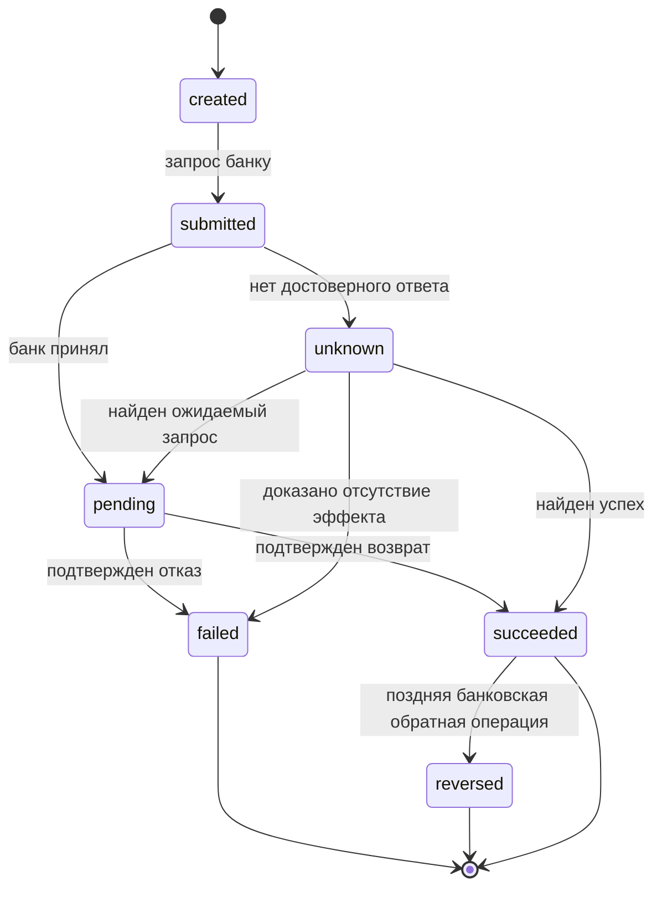
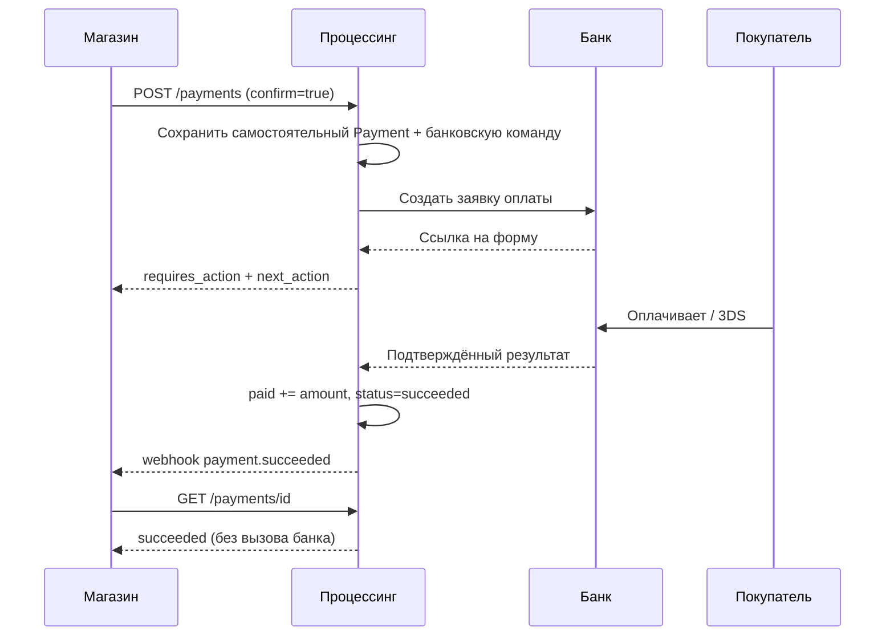
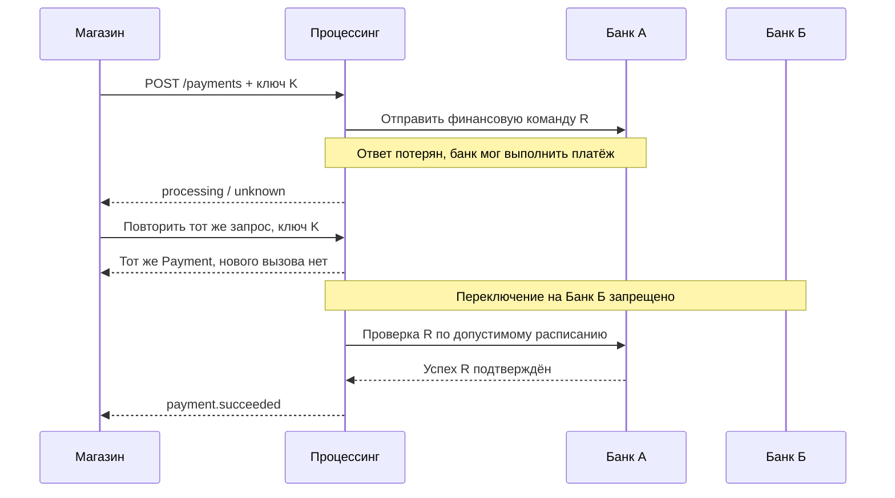

# Платёжный процессинг — спецификация жизненного цикла платежей v0.5

**Дата:** 2026-10-09  
**Статус:** BR-01, BR-02 и BR-02.1 согласованы; BR-03—BR-06 и прочие технические решения пока проекты.  
**Связанные документы:** `payment-processing-decisions-v0.4.md`, `payment-processing-architecture-v0.4.md`, `payment-api-v0.5.openapi.yaml`, `acquirer-connector-contract-v0.4.md`.  
**Область:** приём оплаты картами, СБП и в перспективе кошельками; банки-эквайеры подключаются через независимые соединители; расчёты с продавцами напрямую через банк — текущая гипотеза.

> **Отделение фактов от предложений.** `[Б]` — решение заказчика, `[И]` — сведения из предоставленных материалов или официальных документов внешних продуктов, `[П]` — предлагаемое правило процессинга, требующее утверждения. Отсутствие у ТКБ описания отдельного действия или кода **не доказывает**, что банк его не поддерживает.
>
> **Безопасность.** Здесь нет реальных ключей, адресов тестового стенда, номеров карт и секретов из Postman. Запросы к тестовому контуру не выполнялись.

## 1. Цель и границы

### 1.1. Входные решения заказчика [Б]

- Начальные клиенты: юридические лица, ИП и физические лица на НПД, которые продают **собственные** товары и услуги.
- Единое дистанционное подключение в нашем кабинете, без самостоятельной интеграции продавца с банками.
- Публичный независимый API: создание/статус оплаты, полный/частичный возврат, холдирование, подтверждение, привязка карт, повторные списания; карты, СБП, последующее расширение на кошельки.
- Несколько банков с разными протоколами; первый исследуемый стенд — ТКБ.
- Ориентир нагрузки не менее 100 RPS публичного интерфейса; это не подтверждённый лимит банка.

### 1.2. Сейчас вне объёма [Б/П]

Распределение одного платежа между несколькими получателями, массовые выплаты и хранение денежных остатков пользователей; самостоятельная НКО; пользовательский ввод PAN/CVV в нашем API; гарантированная переносимость банковского токена карты; обещание множественных частичных подтверждений холда в первом выпуске.

### 1.3. Разделение независимого платежа и управляемой покупки [Б / П]

**[Б] Согласовано BR-01:** `Payment` — один самостоятельный жизненный цикл банковской оплаты. `PaymentIntent` — необязательная верхняя сущность для одной покупки; она создаёт несколько *последовательных* отдельных `Payment`, если покупатель явно начинает следующую оплату после доказанного отказа. В прямом режиме продавец работает с `Payment` без `PaymentIntent`.

- `PaymentIntent` — управление оплатой покупки: одни `merchant_id`, `order_id`, сумма, валюта и настройки для всех детей; дочерние платежи создаются **только через** `POST /payment_intents/{id}/confirm`.
- `Payment` — единая самостоятельная оплата и один выбранный маршрут/банковская сессия. Не использует отдельную публичную сущность `PaymentAttempt`. Прямые платежи не присоединяются к намерениям задним числом.
- `PaymentOperation` — финансовая команда и факт `debit`, `authorize`, `capture`, `void`, `refund` над конкретным `Payment`.
- `Refund` — публичный ресурс возврата, связанный с конкретным `Payment`; несколько возвратов допускаются в рамках банка и финансовых ограничений.
- `AcquirerConnection` — разрешённое подключение продавца к банку, фиксируемое для данного `Payment` при первой отправке.
- `DispatchIntent` — **техническая запись намерения отправить банковскую команду**, не путать с публичным `PaymentIntent`.
- `SettlementRecord` — информация о перечислении продавцу, не определяет успешность оплаты.

**[Б] Только повторы по действию покупателя:** после отказа новый дочерний платёж появляется только по новому вызову `confirm`, сделанному по действию покупателя; сервер процессинга не запускает цикл повторов сам. Технические повторы *той же* банковской команды допустимы лишь при доказанной безопасности и не являются новой оплатой.

**[П] Граница финансовой гарантии:** атомарная блокировка `PaymentIntent` предотвращает создание двух активных дочерних платежей нашим ядром. Если банк позже опровергнет прежний «финальный отказ» и сообщит об успешном списании, это конфликт банковских свидетельств, который требует отдельного разбора; само ядро не может физически исключить ошибочное поведение внешнего банка.

## 2. Основания для модели

| Источник | Что достоверно следует из источника | Ограничение применения |
|---|---|---|
| TKB PAY: `Операции+платежного+шлюза.doc`, коллекция Postman | Есть операции оплаты новой/сохранённой картой, `Hold`, `HoldConfirm`, `HoldReversal`, `Refund`, `Reverse`, `GetOrderState`, СБП и привязки | Коллекция не фиксирует все допустимые переходы и права данного терминала |
| TKB PAY: коллекция Postman, пример `GetOrderState` | Содержит указание: не опрашивать одну операцию чаще одного раза в минуту | Подтвердить лимит с банком; до подтверждения консервативно соблюдать его |
| Stripe — [жизненный цикл PaymentIntent](https://docs.stripe.com/payments/paymentintents/lifecycle) | Отдельные состояния ожидания действия плательщика, обработки и ручного подтверждения | Семантика статусов Stripe **не** становится правилами ТКБ автоматически |
| Stripe — [холдирование](https://docs.stripe.com/payments/place-a-hold-on-a-payment-method) | Срок действия авторизации; однократное частичное списание обычно освобождает остаток | Сроки, превышение авторизации и множественные подтверждения зависят от метода/договора |
| Adyen — [capture](https://docs.adyen.com/online-payments/capture) | Один частичный capture и несколько частичных capture — разные возможности | Множественные подтверждения требуют особой настройки и не входят в базовую гарантию |
| Adyen — [refund](https://docs.adyen.com/online-payments/refund) | Принятый возврат может позднее завершиться неуспехом или быть обращён | Нужен отдельный жизненный цикл возврата, а не только флаг у платежа |
| ЮKassa — [процесс оплаты](https://yookassa.ru/developers/payment-acceptance/getting-started/payment-process) | Подтверждение холда, его отмена и окончательный платёж различаются | Используем как пример российской продуктовой модели, не как протокол банка |
| ЮKassa — [HTTP 500 и неопределённый итог](https://yookassa.ru/developers/using-api/response-handling/recommendations) | Код HTTP сам по себе не всегда даёт финансовый результат | Политика уточнения должна учитывать реальную идемпотентность каждого банка |
| Т-Банк — [подтверждение](https://developer.tbank.ru/eacq/api/confirm) | Списание может быть меньше авторизованной суммы | Семантика повторного подтверждения требует проверки по банку |

## 3. Термины, значения и единицы измерения

| Термин | Значение |
|---|---|
| `requested` | Исходная сумма оплаты, переданная продавцом |
| `authorized` | Подтверждённая **отдельная** авторизация/холд. Для прямого платежа СБП её может не быть |
| `captured` | Сумма подтверждённых операций списания по карточному механизму capture. Для прямого СБП — ноль |
| `paid` | Сумма подтверждённой оплаты в любом инструменте: карта, СБП, кошелёк; **не** факт перечисления продавцу |
| `released` | Подтверждённое освобождение неиспользованного холда |
| `refunded` | Сумма действительных подтверждённых возвратов за вычетом документально подтверждённых обратных корректировок |
| `capture_reserved`, `refund_reserved` | Суммы, забронированные внутри системы для операций в обработке или с неизвестным результатом |
| `capturable`, `refundable` | Остатки, по которым **сейчас разрешено** принять команду; это не сумма на банковском счёте |
| `unknown` | Неизвестен **финансовый результат**, а не просто техническая ошибка |
| `next_action` | Действие плательщика: переход на банковскую форму, открытие приложения, QR и т. п. |
| `order_id` | Идентификатор заказа продавца; **не** уникальный идентификатор вызова банка и сам по себе не ключ идемпотентности |

**Денежные поля [П].** Предлагаю исправить непоследовательность OpenAPI v0.1 (`amount` как объект, `amount_authorized` как число): использовать один `currency` и **все** суммы в объекте `amounts` как целые числа в младших единицах валюты. Пример см. §13. Это **изменение проекта v0.1**, а не уже согласованное требование. На старте поддерживаем только `RUB`; возможность добавления валют закладываем в схему, но не обещаем обработку.

## 4. Две независимые модели состояний

### 4.1. Состояния отдельного `Payment` [Б / П]

| Состояние | Смысл | Финальное? |
|---|---|---|
| `requires_payment_method` | Способ ещё **не выбран при первичном создании**; банковская оплата ещё не начиналась | Нет |
| `requires_confirmation` | Способ выбран, но банковская команда ещё не инициирована | Нет |
| `requires_action` | Банк ожидает форму, 3DS, QR или другое действие | Нет |
| `processing` | Операция выполняется либо результат неизвестен | Нет |
| `requires_capture` | Есть достоверный холд, ждём capture/void | Нет |
| `succeeded` | Достоверно подтверждён положительный итог оплаты / финального capture | Да |
| `failed` | Достоверный окончательный отказ без оплаченной суммы; **новый способ на этом `Payment` не запускается** | Да |
| `canceled` | Отмена без оплаченной суммы и без активного неизвестного эффекта доказана | Да |
| `expired` | Истечение без успешного эффекта доказано банком, а не только местными часами | Да |

**[Б] BR-01:** после `failed`/`canceled`/`expired` нельзя повторно `confirm` тот же `Payment`. `requires_payment_method` теперь означает **только первоначальный** выбор, а не возможность повторять отказанный платёж. Платёж может иметь несколько технических сообщений и операций в банке, но не две независимые оплаты через разные банки.

### 4.2. Состояния `PaymentIntent` [Б / П]

| Состояние | Значение | Допустим новый дочерний платёж? |
|---|---|---|
| `requires_payment_method` | Нет активного дочернего платежа, а право начать следующий ещё действует | Да, если не истекло окно, не исчерпан лимит и нет запрета |
| `requires_action` | Единственный активный дочерний платёж ожидает действие покупателя | Нет |
| `processing` | Исполнение/отмена ребёнка или выяснение исхода; в том числе закрытие ожидает банковского результата | Нет |
| `requires_capture` | Единственный активный дочерний платёж достоверно авторизован | Нет |
| `succeeded` | Один дочерний `Payment` достоверно завершён оплатой | Нет |
| `failed` | Достигнут предел попыток либо применена блокировка по рискам; не осталось финансовой неопределённости | Нет |
| `canceled` | Продавец запросил отмену; отсутствие потенциального финансового эффекта доказано | Нет |
| `expired` | Вышло окно новых попыток; отсутствие активного холда и неопределённых банковских результатов доказано | Нет |

**[Б] BR-02 согласовано 2026-10-09:** не выводить `Intent.failed` из одного отказа. Закрытие происходит по сроку действия, исчерпанию попыток, запросу отмены продавцом или блокировке по рискам. Любое финальное неуспешное состояние возможно лишь после исключения незавершённого финансового эффекта. Числовые пределы и модель раскрытия причин риска согласованы в BR-02.1 (2026-10-09).

### 4.3. Финальность и возвраты

Успешные `Payment` и `PaymentIntent` сохраняют `succeeded` после полного или частичного возврата; операция возврата имеет собственный жизненный цикл. Неизвестный результат банковского платежа не становится `failed` по одному тайм-ауту. Противоречивые поздние банковские сведения создают финансовый инцидент, но не молча переписывают опубликованные финальные итоги.

## 5. Допустимые переходы [Б / П]

### 5.1. Отдельный `Payment`

| Откуда | Куда | Условие |
|---|---|---|
| Создание | `requires_payment_method` / `requires_confirmation` | Способ не выбран / выбран до банковской отправки |
| Создание либо подтверждение | `requires_action`, `processing`, `requires_capture`, `succeeded` | Банк запросил действие / обрабатывает / подтвердил холд / подтвердил прямую оплату |
| `requires_payment_method` | `requires_confirmation`, `requires_action`, `processing` | **Первичный выбор** способа, до отправки в банк |
| `requires_confirmation` | `requires_action`, `processing`, `requires_capture`, `succeeded` | Первичная отправка в банк и её проверенные ответы |
| `requires_action` | `processing`, `requires_capture`, `succeeded`, `failed` | Продолжение проверки либо окончательный исход **той же** банковской сессии |
| `processing` | `requires_action`, `requires_capture`, `succeeded`, `failed` | Новый шаг того же банковского сеанса, авторизация, оплата либо достоверный отказ |
| `requires_capture` | `processing`, `succeeded`, `canceled` | Capture/void начат, подтверждён или успешно отменён |
| `processing` | `requires_capture` | Capture/void доказанно не выполнен, исходный холд действует (уточнение v0.2a) |
| Нефинальное | `canceled` / `expired` | Отсутствие списания, холда и невыясненной операции подтверждено |

**Запрещено:** `failed → requires_payment_method`, `failed → requires_confirmation`, повторное подтверждение `failed`, перевод `succeeded` в `failed` после возврата. `Payment.status=failed` допустим только при доказанном отказе **без** финансового эффекта; если активен холд, требуется отдельная обработка.

### 5.2. `PaymentIntent`

| Откуда | Куда | Основание |
|---|---|---|
| Создание | `requires_payment_method` | Намерение создано, дочерних платежей нет |
| `requires_payment_method` | `processing` | Новый `confirm` **по действию покупателя**, атомарно создаёт новый `Payment` и фиксирует его |
| `processing` | `requires_action` | Дочерняя оплата ждёт действия плательщика |
| `processing`, `requires_action` | `requires_capture` / `succeeded` | Банк подтвердил холд / списание дочернего `Payment` |
| `requires_action` | `processing` | Дочерний платёж вновь обрабатывается |
| `requires_action`, `processing` | `requires_payment_method` | Дочерний `Payment` окончательно завершён без эффекта и нет триггера закрытия BR-02 |
| `requires_capture` | `processing`, `succeeded`, `canceled` | Capture/void дочернего платежа и проверенный результат |
| Нефинальное | `canceled`, `expired`, `failed` | После запроса отмены / срока / лимита / блокировки, ТОЛЬКО если исключены финансовая неопределённость и активный холд |

При `processing` с возможным списанием новая оплата **блокируется**, даже если `PaymentIntent.cancel` уже вызван. Никакого автоматического `confirm` из состояния `requires_payment_method` нет. Автоматическое переключение банков после отказа также запрещено BR-01.

## 6. Корреляция и контроль дочерних платежей

1. Один `Payment` либо **прямой** (`payment_intent_id=null`), либо создан как ребёнок ровно одного `PaymentIntent`. Перепривязка запрещена.
2. Дочерние `Payment` наследуют от намерения `merchant_id`, `order_id`, `amount`, `currency`, `capture_method`, `outlet_id` и `customer_id` (если есть). Меняется только способ оплаты, разрешённый политикой; выбор банка происходит отдельно для нового `Payment`.
3. На одно намерение допускается не более одного неокончательного дочернего платежа. Проверка и фиксация выполняются в **одной атомарной транзакции** и при разных значениях ключей идемпотентности.
4. Если банк достоверно отклонил текущий `Payment` без финансового эффекта, этот `Payment.failed` финален; `PaymentIntent` возвращается в `requires_payment_method` только при сохранении права новых оплат по BR-02. При срабатывании политики закрывается после проверок.
5. `PaymentIntent.succeeded` вычисляется из достоверно успешного дочернего `Payment`. Успешный холд означает `requires_capture`, а не `succeeded`. При разрешённом финальном частичном capture `amount_paid` у намерения может быть меньше первоначального `amount`: это **не** доказательство полной оплаты заказа; клиент должен сверять суммы. Правила работы с недоплатой остаются открыты до BR-03.
6. Наша гарантия — не запускать два активных независимых банковских платежа **в рамках намерения**. При необратимом противоречии банка после окончательного исхода — блокировка, сохранение всех свидетельств и расследование; возможные корректирующие денежные действия не выполняются без утверждённой политики.
7. `order_id` не служит блокировкой между **разными** намерениями и прямыми платежами. Нужна ли отдельная уникальность заказов — открытый продуктовый вопрос.
8. Внутренняя диагностика может хранить банковские попытки авторизации или взаимодействия внутри одного `Payment`, если банк их раскрывает; они не являются отдельной публичной сущностью и не разрешают создание новой оплаты.

### 6.1. Политика BR-02: окончательное завершение `PaymentIntent` [Б]

**Триггеры блокировки новых дочерних платежей:**

| Причина | Когда блокировать новый `confirm` | Когда можно выставить окончательный статус |
|---|---|---|
| `payment_window_expired` | `now >= expires_at` | `expired`, только после исключения активного/неизвестного финансового эффекта |
| `attempt_limit_reached` | Достигнут предел начатых банковских попыток | `failed`, при подтверждённом отсутствии активного/неизвестного финансового эффекта |
| `merchant_canceled` | Продавец запросил отмену | `canceled`, когда отмена/отсутствие эффекта доказаны |
| `risk_blocked` | Правила безопасности запретили новые оплаты | `failed` с причиной риска — проект отображения; после разрешения банковских неопределённостей |

- Истечение срока **запрещает новые попытки**, но не объявляет банковский платёж истекшим. Начатая ранее оплата может завершиться успешным списанием; это фиксируется по факту, а не отвергается из-за локального времени.
- `processing` с `closure_pending_reason` — **предлагаемая внутренняя модель** ожидания, не новый публичный статус. `can_confirm=false`; публичный ответ объясняет причину ожидания без раскрытия закрытых правил риска.
- Успешный дочерний платёж переводит намерение в `succeeded`, даже если по локальным часам окно уже закончилось: деньги получены. При последующей отмене заказа решение о возврате — BR-05, в рамках BR-02 возврат автоматически не создаётся.
- При существующем `requires_capture` окно новых попыток не освобождает холд и не блокирует допустимый `capture`/`void` по срокам банка. Намерение не переводится в `expired` при активной авторизации.
- Прямые `Payment` без `payment_intent_id` не получают ограничений попыток и срока **намерения**; их собственные банковские сроки действуют независимо.
- Финальные `failed`, `expired`, `canceled` не открываются повторно. Позднее противоречивое банковское событие — инцидент сверки и отдельный финансовый факт, без молчаливой подмены истории.

### 6.2. Параметры и подсчёт попыток [П — техническая детализация]

- **[Б] BR-02.1:** `PaymentIntent` по умолчанию действует **30 минут**; продавец может выбрать срок **5 минут — 24 часа** включительно. Число попыток по умолчанию **5**, настройка **1–10** включительно. В настройках — `ttl_seconds` = 1800 (допустимо 300–86400), `max_attempts` = 5 (допустимо 1–10).
- **[П] Подсчёт:** `attempts_used` — число дочерних оплат, достигших потенциальной отправки финансового/платёжного запроса в банк (`dispatch_started`). До доказанной неотправки слот считается занятым. При достоверно доказанной неотправке слот можно освободить (атомарно, без двойного вычета). Простое создание объекта, повтор `Idempotency-Key` и внутренний повтор доставки той же команды **не** добавляют попытку.
- Действия пользователя внутри банковской платёжной формы не порождают новые `Payment`, если банк не открывает новую независимую платёжную сессию у нас.
- `can_confirm` — вычисляемое право инициировать следующую попытку **на момент ответа**: состояние разрешает, окно открыто, лимит не исчерпан, нет активного ребёнка и блокировки. Для защиты от гонок все условия **перепроверяются атомарно** при `confirm`.
- **[П] Граница времени:** `expires_at` вычисляется при создании намерения из снимка настроек; если передан явно, проверяется диапазон **300–86400 секунд** относительно времени создания и политика продавца. Проверка выполняется атомарно при `confirm` и непосредственно перед банковской отправкой. Если срок истёк до потенциальной отправки — отменить ещё не отправленную команду без списания попытки; при неопределённой отправке запрещено считать её неотправленной. Это предложение технического правила, подлежащее проверке на испытаниях.
- Повтор ранее принятого вызова с тем же ключом идемпотентности возвращает ранее созданный ресурс/ответ, даже если сейчас `can_confirm=false`; это не новая попытка. Новый ключ после блокировки получает ошибку состояния без вызова банка.
- **[Б] Неизменность:** `ttl_seconds`, вычисленный `expires_at` и `attempts_limit` фиксируются при создании; дальнейшие изменения настроек продавца влияют только на новые Intent. Для аудита предлагается сохранять версию настроек.
- **[П] Независимость банков:** индивидуальный срок банковской формы, QR, холда, тайм-ауты и окончательные статусы не подменяются сроком Intent. Банковские ограничения могут дополнительно сократить допустимость операции.
- При нескольких одновременно возникших причинах закрытия следует сохранять исходные события и однозначно определять итоговую `closure_reason`. Правило приоритета между конкурирующими причинами — отдельное техническое уточнение, не включённое в BR-02/BR-02.1.

### 6.3. BR-02.1 — кто видит причины риск-блокировок [Б / П]

| Уровень | Согласованная видимость | Предложение по реализации |
|---|---|---|
| Покупатель [Б] | Нейтральное сообщение «Оплата сейчас недоступна. Обратитесь в магазин». Не показывать подозрительные признаки, коды сработавших правил и рекомендации по обходу | Публичная платёжная форма получает только безопасный код `payment_unavailable`, **не** получает внутренний объект проверки риска [П] |
| Продавец [Б] | Общая категория причины и идентификатор обращения в поддержку, без подробных правил | В авторизованном серверном API и кабинете `closure_reason=risk_blocked` только **после** финального закрытия, `support_reference` — непрозрачная ссылка на обращение [П] |
| Уполномоченный сотрудник компании [Б] | Конкретные основания, история и версия правила | Отдельный защищённый журнал с проверкой полномочий, аудитом доступа и минимумом персональных данных [П] |

- При временной проверке риска немедленно запрещать новый `confirm`, но не объявлять `failed` до окончательного решения и исключения неопределённого финансового эффекта. Внешний `status=processing` используется, если есть активное выяснение; иной способ показа ожидания проверки без финансовой операции требует отдельного проектирования [П].
- `closure_reason` и `support_reference` — **не поля пользовательской платёжной формы**. Магазин не должен напрямую передавать ответ своего серверного API плательщику [П].
- Антифрод-признаки, веса правил, версии внутренних расследований и необработанные банковские данные не попадают в `metadata`, исходящие веб-уведомления и публичные журналы [П].
- Если банк позже подтвердит уже начатую оплату, платёжное ядро зафиксирует финансовый эффект независимо от риска; судьба заказа и возврата остаётся открытым BR-05 [Б: требование учёта, П: дальнейшая политика].

## 7. Финансовые операции `PaymentOperation` [П]

### 7.1. Виды операций

- `authorize` — создать холд конкретного `Payment`.
- `capture` — подтвердить ранее удержанные деньги полностью или частично.
- `void` — отменить неиспользованную авторизацию без создания возврата списанных средств.
- `refund` — вернуть уже подтверждённую оплаченную сумму.

**Не объединять** `void` и `refund` в одну внутреннюю операцию, даже если банк применяет один endpoint в разных стадиях. Соединитель выбирает банковский метод исходя из состояния и фактического финансового действия.

### 7.2. Статусы финансовой операции

| Статус | Значение |
|---|---|
| `created` | Создана и сохранена; деньги забронированы от конкурентных команд внутри процессинга |
| `submitted` | Банковская команда была отправлена |
| `pending` | Банк подтвердил принятие, но результат не окончательный |
| `unknown` | Неизвестно, совершено ли действие; резерв суммы сохраняется |
| `succeeded` | Окончательный успешный результат по доступному контракту банка |
| `failed` | Окончательный отказ, финансового эффекта нет |
| `reversed` | Ранее подтверждённая операция позже отменена/обращена банком; отдельный компенсирующий факт обязателен |

`pending` — **известно**, что банк принял операцию, но неизвестно, успешно ли она закончится. `unknown` — неизвестно даже это или имеются противоречия. Для безопасности резерв суммы одинаково сохраняется в обоих случаях.

**Ресурс `Refund`** может публично использовать статусы `pending`, `processing`, `succeeded`, `failed`, `reversed`; поле `processing_reason` позволяет отличить ожидаемый ответ от выяснения неопределённости. `PaymentOperation` и `Refund` не должны независимо менять деньги: один финансовый результат учитывается ровно один раз.

### 7.3. Операции и разрешённые действия

| Состояние платёжного объекта | Команда | Действие |
|---|---|---|
| `requires_capture`, `capturable > 0` | `capture` | Разрешить в пределах подтверждённого холда, если нет конфликтующих in-flight операций |
| `requires_capture`, `paid=0` | `cancel` | Запустить `void`, завершить после подтверждения |
| `succeeded`, `refundable > 0` | `refund` | Разрешить по проверенной сумме; асинхронное завершение |
| `processing` с неопределённым платежом | повторный `confirm` / новая оплата в том же `PaymentIntent` | Запретить до установления исхода дочернего платежа |
| `processing` с неопределённым capture | новый `capture`/`void` | Запретить конфликтующее изменение холда |
| `succeeded` | `cancel` | Отклонить: использовать `refund` |
| `canceled`/`failed`/`expired` | `capture`/`refund` | Отклонить, кроме явно документированной поздней банковской корректировки в служебном контуре |
| `requires_action` | `refund` | Отклонить: нет подтверждённой оплаченной суммы |

## 8. Холдирование и списание [П]

### 8.1. Обязательный вариант для первого выпуска

`capture_method=manual` означает авторизацию без окончательного списания. На подтверждённом холде:

- `requested=100000`, `authorized=100000`, `paid=0`, `capturable=100000`, `status=requires_capture`;
- допустим один `capture` на сумму `0 < x <= capturable`;
- после **достоверного** подтверждения частичного `capture(x)`: `paid=x`, `captured=x`, остаток освобождён согласно подтверждению банка, `capturable=0`, `status=succeeded`;
- освобождение остатка **не** трактуется как денежный возврат: `refunded=0`.

При неподтверждённом результате capture `Payment.status=processing`, операция `pending/unknown`, резерв сохраняется. Повторным `capture` нельзя списать вторую сумму, пока не решён исход первой команды.

### 8.2. Необязательное расширение: несколько частичных capture

`multiple_partial_captures` — отдельная банковская возможность, **не обещается v1**. Если когда-либо включим её для конкретного подключения:

- требуется поле `final_capture` в публичной команде (предложение для следующей версии OpenAPI);
- `capture(x, final_capture=false)` после успеха оставляет `requires_capture` и уменьшает `capturable`, но не делает платёж финально оплаченным;
- финальное подтверждение или истечение остатка переводят оплату в `succeeded`, **если paid>0**;
- каждая частичная операция имеет свой ID и банковский идентификатор;
- `sum(confirmed captures + reserved captures)` никогда не превышает разрешённый остаток.

По документации Adyen оставшиеся средства при одиночном частичном capture автоматически освобождаются; множественный capture — отдельная настройка: https://docs.adyen.com/online-payments/capture.

### 8.3. Истечение авторизации

- `authorization_expires_at` вычисляется только из достоверных ограничений банка и конкретного инструмента. Значение не придумывается по умолчанию.
- До истечения возможен capture/void. По истечении **локального** таймера без подтверждения банка мы прекращаем новые операции, но не объявляем банковские деньги свободными.
- Если подтверждено, что hold истёк и `paid=0`, `Payment.status=expired`. Если `paid>0`, `succeeded`, а остаток холда освобождён.
- Для операции с `unknown` истечение таймера запускает проверку, а не автоматическое `expired`.

## 9. Возвраты [П]

### 9.1. Создание

`POST /v1/refunds` требует успешную оплаченную сумму и `Idempotency-Key`.

Для принятия запроса в **одной атомарной операции хранилища** проверяем:

```
0 < requested_refund <= refundable
refundable = paid - refunded - refund_reserved
```

Здесь `paid` — подтверждённая полученная сумма, а `refunded` — нетто-возвраты после корректировок. Нельзя включать в возврат суммы, которые ещё только предполагается списать. Резерв `refund_reserved` снимается **лишь** после достоверного отрицательного исхода или окончательного учёта подтверждённого возврата/его обращения.

Если `amount` при создании `Refund` отсутствует, предлагается возвращать **весь доступный `refundable`** на момент атомарного бронирования. Значение фиксируется в `Refund.amount` и никогда не меняется при повторе того же ключа.

### 9.2. Состояния возврата



Внешний статус `Refund.status=processing` объединяет `submitted`/`unknown`; `pending` сохраняется при известном принятии. После `reversed` обновляется нетто-сумма `refunded` через **новый компенсирующий факт**. Финансовый журнал неизменяем.

Если банк подтверждает только отправку возврата на последующую обработку, нельзя преждевременно объявлять `succeeded`. Критерий финального успеха определяется профилем соединителя на основании документально согласованной семантики банковских событий и реестров.

### 9.3. Несколько частичных возвратов

Разрешаем несколько `Refund` для одной успешной оплаты, когда банк и метод это поддерживают (`partial_refund`, `multiple_refunds`). Одновременные запросы должны бронировать остаток атомарно. При `paid=100000`, подтверждённом `refunded=30000` и уже принятом, но незавершённом возврате `refund_reserved=50000`, ещё доступно **20000**, а не 70000.

Один и тот же запрос с прежним ключом не создаёт нового ресурса. Новый ключ не разрешает обходить ограничение остатка.

## 10. Неопределённость и восстановление

### 10.1. Типовые ситуации

| Ситуация | Что можно утверждать | Что делать |
|---|---|---|
| Банк достоверно отказал без списания | `Payment.failed`, финансового эффекта нет | Для управляемого режима можно разрешить новый дочерний Payment по действию покупателя; прямому клиенту — создать отдельный Payment |
| Время ожидания HTTP истекло после отправки | Финансовый результат **неизвестен** | `unknown`, сохранить резерв, запретить второй маршрут |
| Банк вернул HTTP 500 | Нельзя по одному HTTP-коду доказать отказ | `unknown`, уточнение по документированной процедуре |
| Ответил «заявка принята» | Обработка началась, успешность не подтверждена | `pending`, ждать событие/допустимый запрос статуса |
| Пользователь вернулся с `return_url` | Браузер прошёл по ссылке; денег это не подтверждает | Отдать сохранённый статус, дождаться независимого подтверждения |
| Банк прислал дубликат уведомления | Повторная доставка возможна | Проверить подлинность; дедупликация, не удваивать суммы |
| Банк прислал старое событие после нового | Порядок не гарантируется | Записать событие, не откатывать установленный факт; при конфликте выяснять |
| Компонент упал до отправки | Если доказуемо не было отправки — можно выполнить сохранённую команду | Восстановить по журналу отправки |
| Компонент упал после отправки до ответа | Отправка могла состояться | Не отправлять как новую финансовую операцию без доказанной идемпотентности у банка |

### 10.2. Алгоритм разрешения `unknown`

1. Сохранить команду, наш ID, idempotency key, выбранный `AcquirerConnection`, **точное назначенное до отправки внешнее reference**, состояние `unknown` и наличие резерва. Не создавать альтернативный дочерний `Payment` внутри того же `PaymentIntent`.
2. Проверить, есть ли достоверно сохранённый ответ/подписанное уведомление по этому reference.
3. Запросить состояние у **того же** банка, если его протокол поддерживает корреляцию. Соблюдать ограничения частоты (для TKB PAY в коллекции `GetOrderState` указано не чаще одного опроса операции в минуту).
4. Если метод статуса не даёт доказательства, использовать банковские реестры и сверку; при необходимости открыть случай ручного разбора.
5. Разрешить повтор **той же** банковской команды только при явно подтверждённой серверной идемпотентности банка с этим reference и действующей гарантией срока; иначе повтор недопустим.
6. Обновить исход, финансовые записи и доступные команды **атомарно**, сформировать событие клиенту. Если доказательств нет, оставаться `unknown` даже после истечения обычного HTTP-тайм-аута.
7. При двух несовместимых достоверных сообщениях — сохранить оба, не перезаписывать «последним пришедшим», открыть инцидент сверки и блокировать новые рискованные операции.

**Важно:** ограничение на длительность неопределённости (время для ручного разбора/оповещения) **не является** сроком, по истечении которого невыясненный платёж автоматически считается отказанным.

### 10.3. Клиентский интерфейс при неопределённости

`GET /payments/{id}` читает последнее безопасно сохранённое состояние и не вызывает банк синхронно. При `processing` можно вернуть:

```json
{
  "id": "pay_example",
  "status": "processing",
  "processing": {
    "reason": "provider_result_unknown",
    "since": "2026-10-09T07:00:00Z"
  },
  "next_action": null
}
```

Это **предлагаемое** расширение схемы ответа, не фактический ответ какого-либо банка. Причины ошибок и банковские секреты клиенту не раскрываются.

## 11. Идемпотентность, параллелизм, события [П]

### 11.1. Входящий API и повторные покупки

- Обязательный `Idempotency-Key` для создания `Payment`, создания `PaymentIntent`, `confirm` обоих ресурсов, capture, отмены, возврата и привязки.
- Область уникальности: `(merchant_id, тип команды, идентификатор ресурса при наличии, key)`; отпечаток нормализованного тела запроса включает бизнес-значимые параметры.
- Тот же ключ и тело возвращают зафиксированный результат **исходного** вызова (для управляемого `confirm` — то же намерение с тем же дочерним ID, который создал этот вызов) и не запускают банк второй раз. Если позже `latest_payment_id` изменился, актуальное состояние получают через GET, а не повтором старого `confirm`.
- Тот же ключ, но другое тело → `409 idempotency_key_conflict`, без вызова банка.
- Разные ключи при параллельном `PaymentIntent.confirm` не дают параллельных дочерних платежей: ровно один атомарно создаётся; другой получает `409 payment_intent_busy`. Это не то же самое, что повтор запроса с тем же ключом.
- Прямой `Payment.confirm` разрешён только до первой реальной инициации банковского сеанса. После `failed` создаётся **новый Payment**, а не новый способ внутри старого.
- Управляемый `PaymentIntent.confirm` с новым ключом и новым выбором способа разрешён только в `requires_payment_method` и только после действия покупателя.
- `order_id` не заменяет ключ идемпотентности и сам по себе не запрещает несколько независимых прямых платежей или разных намерений. Запрет повторной оплаты одного заказа на уровне магазина **не согласован**.
- Срок хранения ключей должен охватывать окно финансового риска, но количественный норматив пока не утверждён.

### 11.2. Финансовые блокировки

В одной транзакции проверять `payment.version`, состояние, денежные ограничения и сохранять новый резерв/операцию. На один холд не запускать конкурирующие `capture` и `void`; на один возврат не запускать одновременно повторные физические отправки. Для нескольких возвратов одного платежа допускается параллельность лишь при строгом атомарном резервировании остатка и правилах конкретного банка.

### 11.3. Входящие банковские события

Проверяем подлинность **до** изменения финансового состояния. Сохраняем ID сообщения/технический отпечаток, reference платежа и операции, факт времени у источника, время получения и результат разбора. Дубликат обработать без повторного начисления. Отсутствие доставки не должно навсегда блокировать уточнение через банковский статус и сверку.

### 11.4. Исходящие уведомления продавцам

Предлагаемые события (названия обсуждаемы):

- `payment.requires_action`, `payment.processing`, `payment.requires_capture`, `payment.succeeded`, `payment.failed`, `payment.canceled`, `payment.expired` — события **конкретного платежа**;
- `payment_intent.requires_payment_method`, `payment_intent.requires_action`, `payment_intent.processing`, `payment_intent.requires_capture`, `payment_intent.succeeded`, `payment_intent.failed`, `payment_intent.canceled`, `payment_intent.expired` — события агрегированного намерения в управляемом режиме;
- `capture.pending`, `capture.succeeded`, `capture.failed`;
- `refund.pending`, `refund.succeeded`, `refund.failed`, `refund.reversed`;
- `payment.reconciliation_required` — только по специально согласованному доступу для технических клиентов.

Отправка — как минимум один раз с повторными попытками; `event_id` неизменен при повторной доставке, подпись проверяемая, обработчик продавца должен дедуплицировать по `event_id`. Событие ребёнка включает `payment_intent_id`; событие намерения — `latest_payment_id`/`successful_payment_id`. Для исполнения заказа продавец выбирает **один источник истины**: `payment_intent.succeeded` в управляемом режиме либо `payment.succeeded` в прямом. Если подписан на оба, необходима дедупликация на уровне `order_id`/объекта намерения. Факт получения HTTP 2xx от продавца не влияет на финансовый статус.

## 12. Правила по способам оплаты [П]

| Возможность | Карта: автоматическое списание | Карта: ручной capture | СБП, обычная оплата QR | Сохранённая карта |
|---|---|---|---|---|
| Ожидание покупателя | Возможно (форма, 3DS) | Возможно | Обычно QR/приложение банка | Может не требоваться; зависит от CIT/MIT |
| Авторизация/холд | Внутреннее банковское действие не обязано быть публичным | Да | В стандартном QR-сценарии нет карточного холда | Зависит от выбранного режима |
| `capture` | Не нужен отдельно | Нужен | Не применяется для обычного одноэтапного QR | Только если разрешён режим |
| `refund` | После успешной оплаты | После успешного capture | После подтверждённой оплаты и при наличии возможности банка | После успешного списания |
| Повтор через другой банк после `unknown` | Запрещён | Запрещён | Запрещён | Запрещён |
| Банковский токен | Не обязателен | Не обязателен | Не применим к карте | Обязателен совместимый токен или иной разрешённый механизм |

**СБП с двумя этапами.** В обзоре TKB PAY встречаются `SbpCheck`/`SbpConfirm` и упоминание двухстадийной СБП. **Не приравнивать** их к обычному карточному `capture` без отдельной банковской спецификации торгового сценария. До подтверждения отдельный режим не включаем в публичные обещания.

**Повторные списания.** Каждое списание сохранённой картой создаёт **новый Payment**. `SetupSession` имеет собственный жизненный цикл (`requires_action`, `processing`, `succeeded`, `failed`, `canceled`) и сам по себе не означает оплату. У токена хранятся владелец, область применения, банк/терминал, согласие и тип сценария (с участием клиента/без участия); банковский токен одного эквайера нельзя автоматически использовать через другой.

## 13. Предложение по публичной модели денег (изменение OpenAPI v0.1)

В `payment-api-v0.1.openapi.yaml` `amount` — объект `{value,currency}`, а `amount_authorized`, `amount_captured`, `amount_refunded` — числа. Эта неоднородность усложняет контракт. Предлагаю вместо неё:

```json
{
  "id": "pay_example",
  "status": "succeeded",
  "currency": "RUB",
  "amounts": {
    "requested": 100000,
    "authorized": 100000,
    "captured": 60000,
    "paid": 60000,
    "released": 40000,
    "refunded": 20000,
    "capture_reserved": 0,
    "refund_reserved": 0,
    "capturable": 0,
    "refundable": 40000
  }
}
```

Это пример платежа на **1000 ₽**, с подтверждённым частичным capture **600 ₽**, освобождением холда **400 ₽** и поздним возвратом **200 ₽**. Для простой одноэтапной СБП `authorized=0`, `captured=0`, `paid=requested` после подтверждения; иначе термин `captured` ложно намекал бы на карточную механику. Все числа — копейки, единственная валюта у платежа. **Это вариант API v0.2 на согласование**, а не правка действующей OpenAPI v0.1.

Дополнительные правила:

1. `paid` определяется только подтверждённым успешным платежом/capture; не увеличивается при одном лишь создании банковской заявки.
2. `refunded + refund_reserved <= paid` (для стандартного сценария без отдельного оспаривания/отрицательных корректировок; корректировки проводятся особыми фактами).
3. При ручном capture: `captured + released + capturable + capture_reserved <= authorized`; остаток, ожидающий подтверждения банка, **не должен** быть ошибочно назван `released`.
4. `currency` платежа и всех его операций совпадает; конвертация и мультивалютные возвраты не входят в первый выпуск.
5. Для клиента `paid` значит успешную оплату, но **не** выплату продавцу; перечисление требует отдельного реестра.
6. Дополнительные комиссии банка/магазина не вычитать автоматически из `paid` или `refunded`; они учитываются отдельными сущностями и договорными правилами.

### 13.1. Изменения к предыдущему проекту API (BR-01, BR-02, BR-02.1 согласованы; BR-06 открыт)

| Что в v0.1 | Изменение проекта v0.2 | Зачем |
|---|---|---|
| `amount` объект, `amount_*` числа | `currency` + однородный `amounts` | Ясная единица измерения для всех сумм |
| `POST /payments/{id}/capture` только `amount` | В дальнейшем `final_capture` и отдельная `CaptureOperation` | Для возможного multiple capture и асинхронности |
| `POST /payments/{id}/confirm` без тела | Возможность выбрать **первоначальный** `payment_method` до первой отправки | На `Payment` нет повторных банковских оплат после отказа (BR-01) |
| `PaymentAttempt` внутри одного `Payment` | Убрать публичную/обязательную предметную сущность; добавить `PaymentIntent` над дочерними `Payment` | BR-01: разные самостоятельные платежи одной покупки |
| `Refund.status` без `reversed` | Добавить `reversed` и причину | Поздний обратный возврат |
| `PaymentOperation.status` только `pending/processing/succeeded/failed` | Уточнить `unknown`, `reversed`, `submitted` внутри ядра | Не терять неизвестный результат и поздние события |
| `Payment.status=processing` без пояснения | Опциональная `processing.reason` | Клиент понимает, требуется ли действие или ожидание |

## 14. Примеры последовательностей

### 14.1. Карта: одностадийная оплата



### 14.2. Холд, частичное списание и возврат

```mermaid
sequenceDiagram
    participant M as Магазин
    participant P as Процессинг
    participant B as Банк
    M->>P: Создать Payment (manual)
    P->>B: Авторизация на 1000 рублей
    B-->>P: Холд подтверждён
    P-->>M: requires_capture
    M->>P: Capture 600 рублей
    P->>P: Резерв capture на 600 рублей
    P->>B: Подтверждение холда на 600
    B-->>P: Итог capture + освобождение 400
    P-->>M: succeeded; paid=600 рублей
    M->>P: Refund 200 рублей
    P->>P: Резерв возврата 200
    P->>B: Возврат 200
    B-->>P: Окончательно подтверждено
    P-->>M: refund.succeeded; payment остаётся succeeded
```

### 14.3. Тайм-аут после отправки



### 14.4. Управляемое намерение: отказ и новая оплата по действию покупателя [Б]

```mermaid
sequenceDiagram
    participant B as Покупатель
    participant M as Магазин
    participant P as Процессинг
    participant A as Банк А
    participant C as Банк Б
    M->>P: POST /payment_intents (order_id, amount)
    P-->>M: pi_001 requires_payment_method
    B->>M: Выбор карты №1, кнопка оплаты
    M->>P: POST /payment_intents/pi_001/confirm K1
    P->>P: Атомарно создать pay_001, связать с pi_001
    P->>A: Платёж pay_001
    A-->>P: Доказанный отказ без списания
    P->>P: pay_001 failed; pi_001 requires_payment_method
    B->>M: Выбор карты №2, кнопка оплаты
    M->>P: POST /payment_intents/pi_001/confirm K2
    P->>P: Атомарно создать pay_002, связать с pi_001
    P->>C: Платёж pay_002
    C-->>P: Подтверждённый успех
    P->>P: pay_002 succeeded; pi_001 succeeded
    P-->>M: payment_intent.succeeded + ссылка на pay_002
```

**Ветвь `unknown`:** если банк А не подтвердил отказ, `pay_001` и `pi_001` остаются `processing`, новый `confirm` с K2 блокируется независимо от выбора банка Б. Повтор K1 возвращает `pay_001` без второй отправки.

### 14.5. Прямой режим: ответственность продавца [Б]

Магазин создаёт `pay_001` через `POST /payments`. После доказанного отказа `pay_001=failed`. Магазин **сам**, по своей логике и пользовательскому действию, может создать `pay_002` с тем же `order_id`; `payment_intent_id` у обоих равен `null`. Процессинг не объединяет их в одно намерение и не обещает защиты от двойной оплаты **между разными `Payment` одного заказа**.

## 15. Набор проверок и приёмочных сценариев

Все проверки должны выполняться сначала на **симуляторе банков**, а затем — на доступных банковских тестовых сценариях. Не следует создавать реальные финансовые операции без специально согласованного тестового контура.

| ID | Сценарий | Проверка результата |
|---|---|---|
| LC-01 | `confirm=false` | `requires_confirmation`, банк не вызван |
| LC-02 | Карточная форма/3DS | `requires_action`, возврат браузера сам по себе не ставит `succeeded` |
| LC-03 | Карта, одноэтапный успех | Один самостоятельный `Payment`, `paid=requested`, `succeeded` |
| LC-04 | Прямой платёж, карточный отказ | Исходный `Payment.failed` финален; новая оплата создаёт отдельный `Payment` |
| LC-05 | Повтор confirm отказанного прямого платежа | `409`, без повторной команды в банк; BR-02 применяется только к PaymentIntent |
| LC-06 | Ручной hold успешен | `requires_capture`, `capturable=authorized` |
| LC-07 | Полный capture | `succeeded`, `paid=authorized`, `capturable=0` |
| LC-08 | Однократный частичный capture 60% | `succeeded`, только 60% оплачено, 40% освобождено по подтверждению банка |
| LC-09 | Запрос capture больше остатка | `422`/доменная ошибка без вызова банка |
| LC-10 | Истечение холда без оплаты | `expired` только при достоверном подтверждении |
| LC-11 | Отмена холда | После `void.succeeded` — `canceled`, `paid=0` |
| LC-12 | Одновременные capture и void | Одна команда отвергнута или сериализована; не два финансовых эффекта |
| LC-13 | Полный возврат | Отдельный `Refund`, платёж остаётся `succeeded` |
| LC-14 | Два частичных возврата | Сумма net возвратов не больше `paid` |
| LC-15 | Два одновременных возврата, каждый 70% | Не может быть принято оба при недостаточном остатке |
| LC-16 | Ошибка банка до окончательного возврата | `Refund.failed`, резерв освобождён лишь при доказанном отсутствии эффекта |
| LC-17 | Принятый возврат, затем отказ по схеме | Не отмечать как окончательный успех до достаточного подтверждения; инцидент при расхождении |
| LC-18 | Подтверждённый возврат, затем обращён банком | `Refund.reversed`, корректирующий факт, повторный расчёт net refunded |
| LC-19 | Дважды POST с тем же ключом и телом | Один ресурс, один финансовый эффект |
| LC-20 | То же значение ключа, иная сумма | `409`, банк не вызван |
| LC-21 | Два конкурентных POST с одинаковым ключом | Ровно одна исходящая команда |
| LC-22 | HTTP timeout/500 банка | `unknown`, не считать отказом, не переключать банк |
| LC-23 | Потеря ответа после успешной операции банка | Результат восстанавливается по тому же reference |
| LC-24 | Дубликат и старый webhook | Суммы не дублируются, состояние не откатывается |
| LC-25 | Противоречивые достоверные сообщения банка | Режим разбора, без автоматического нового списания |
| LC-26 | СБП: QR успешно оплачен | `paid=requested`, без фиктивного карточного capture |
| LC-27 | СБП: QR локально истёк, банк не подтвердил итог | Не объявлять `expired` до надёжной проверки |
| LC-28 | Карта сохранена в ТКБ, выбран другой банк | Проверка области токена; без совместимости — безопасный отказ/новая привязка |
| LC-29 | Продавец имеет права только в одном банке | Маршрут только через разрешённое подключение |
| LC-30 | 100 RPS GET/создание на симуляторе | Согласованные задержки; нулевые дубли финансовых операций, корректное восстановление после перезапуска |
| LC-31 | Capture HTTP 202, поздний `CAPTURE_FAILED` | Не помечать `succeeded` от одного только 202; сохранить отказ |
| LC-32 | Неизвестная операция старше обычного тайм-аута | Остаётся `unknown`; ручная проверка, никакого автоматического `failed` |

| LC-33 | Управляемый режим: создание намерения | `pi_001.requires_payment_method`, дочерних оплат нет |
| LC-34 | Подтверждение намерения по действию покупателя | Создан ровно один новый `pay_001` со ссылкой на `pi_001` |
| LC-35 | Отказ первого ребёнка, новый выбор покупателя | `pay_001.failed` финален; `pi_001.requires_payment_method`; `pay_002` новый |
| LC-36 | Автоматическая повторная оплата без действия покупателя | Не запускается ни один новый дочерний `Payment` |
| LC-37 | Неизвестный результат ребёнка | Новая дочерняя оплата заблокирована до прояснения исхода |
| LC-38 | Повтор `PaymentIntent.confirm` с тем же ключом | Возвращается тот же intent и тот же child, новых банковских вызовов нет |
| LC-39 | Одновременные `confirm` с разными ключами | Один новый дочерний `Payment`, второй вызов `409 payment_intent_busy` |
| LC-40 | Child дошёл до `requires_action` / `requires_capture` | Intent отражает это состояние и не разрешает новую оплату |
| LC-41 | Child стал `succeeded` | Intent стал `succeeded`; другой child не создаётся |
| LC-42 | Прямые платежи с одним `order_id` | Не связываются в намерение; автоматическая уникальность заказа не обещается |
| LC-43 | Попытка присоединить прямой платёж к Intent | Операция отсутствует/отклонена без изменения связи |
| LC-44 | Разные дочерние суммы / валюта / продавец | Отклонить до вызова банка; параметры намерения неизменны |
| LC-45 | Возврат успешного ребёнка | `Payment` и `PaymentIntent` сохраняют `succeeded`, `Refund` отдельно |
| LC-46 | Уведомления ребёнка и намерения | Корреляция по `payment_intent_id`, идемпотентные события, инструкция против двойного исполнения заказа |
| LC-47 | Поздний успех после прежнего достоверного отказа | Сохранён инцидент, остановлены новые операции; финансовое разбирательство, без молчаливого второго успеха |
| LC-48 | `PaymentIntent.cancel` с неизвестным исходом child | Intent не становится `canceled` до доказанного отсутствия эффекта |

**Примечание к LC-08:** фактическое освобождение остатка у ТКБ ещё предстоит подтвердить тестом и договорной документацией; этот ожидаемый результат — **предлагаемая политика для подключения с поддержкой single partial capture**. При иных банковских возможностях сценарий должен пропускаться или иметь другой профиль.

### 15.1. Дополнительные случаи BR-02 (всё ещё не выполнены)

| ID | Сценарий | Ожидаемый результат |
|---|---|---|
| LC-49 | Окно истекло, детей нет | Intent.expired, `can_confirm=false`, банк не вызван |
| LC-50 | Окно истекло при неизвестном банковском исходе | Intent.processing, `can_confirm=false`, новые оплаты запрещены |
| LC-51 | После окончания окна банк доказал списание | Payment.succeeded, Intent.succeeded; финансовый факт сохранён |
| LC-52 | После окончания окна банк доказал отказ | Intent.expired, нет активного эффекта |
| LC-53 | После исчерпания лимита последний отказ подтверждён | Intent.failed, `closure_reason=attempt_limit_reached` |
| LC-54 | Лимит исчерпан, последняя попытка ещё `unknown` | Intent.processing, не `failed` |
| LC-55 | Отмена продавцом без активных детей | Intent.canceled, `closure_reason=merchant_canceled` |
| LC-56 | Запрос отмены при банковском `unknown` | `can_confirm=false`, окончательного `canceled` нет |
| LC-57 | Блокировка по рискам без активных детей | Новые `confirm` запрещены; отображение `failed/risk_blocked` — проект |
| LC-58 | Истечение окна при действующем холде | Intent.requires_capture, допустимы операции с холдом по банковскому сроку |
| LC-59 | Повтор подтверждения прежним ключом после закрытия | Исходный дочерний Payment и ответ, без второй отправки |
| LC-60 | Новый ключ после закрытия | Ошибка состояния без вызова банка |

**Примечание:** эти тесты и новые сценарии в `acquirer-connector-contract-tests-v0.4.yaml` ещё не запускались. Значения по умолчанию и допустимые границы согласованы BR-02.1.

### 15.2. Дополнительные проверки BR-02.1 (не выполнялись)

| ID | Проверка | Ожидаемый результат |
|---|---|---|
| LC-61 | Создать Intent без настройки магазина | `expires_at=created_at+30m`, `attempts.limit=5` |
| LC-62 | Настроить магазин на 5 минут и 1 попытку | Намерение принимает настройки минимальной границы |
| LC-63 | Настроить магазин на 24 часа и 10 попыток | Намерение принимает настройки максимальной границы |
| LC-64 | Указать срок 299 секунд либо более 86400 секунд | `422`, намерение не создаётся |
| LC-65 | Указать предел 0 либо 11 | Отклонение изменения политики; старые настройки сохранены |
| LC-66 | Создать Intent, затем поменять настройки магазина | Старый Intent не меняется, новый получает новый снимок |
| LC-67 | Пятая попытка начата и отказана | Intent становится `failed/attempt_limit_reached`, шестая не создаётся |
| LC-68 | Повторить старый запрос с тем же ключом после закрытия | Тот же результат, счётчик не увеличивается |
| LC-69 | Банковский `unknown` после истечения окна | `can_confirm=false`, не выставлять финальный отказ до выяснения |
| LC-70 | Временная блокировка по риску при неизвестном исходе | Покупателю нейтральный ответ, у продавца нет подробных правил, сотрудники видят основания |
| LC-71 | Завершённая риск-блокировка без финансового эффекта | Продавцу `risk_blocked` и `support_reference`, покупателю нейтральное сообщение |
| LC-72 | Проверить внутренний риск-журнал неподписанным клиентом | Нет доступа к версиям и признакам правил; отказ в доступе аудитируется |
| LC-73 | Истёк Intent, но действителен банковский холд | Нет автоматического снятия холда из-за срока Intent |
| LC-74 | Одновременно `confirm` и изменение настроек | Применяется сохранённый снимок Intent; лимит проверяется атомарно |

## 16. Ключевые требования для соединителя банка

| Требование | Что должен сообщить/поддерживать соединитель |
|---|---|
| Идентичность команды | Наш `operation_id`, неизменяемый внешний reference, банк, терминал |
| Семантика результата | Отдельно `accepted`, `customer_action`, `authorized`, `paid`, `declined`, `uncertain`; отсутствие выдуманных успехов |
| Финальность | Условия достаточного подтверждения и возможные поздние корректировки |
| Возможности | `manual_capture`, `partial_capture`, `multi_capture`, `partial_refund`, `multiple_refunds`, `sbp_qr`, `tokenized_mit` |
| Сроки | TTL оплаты/QR, дата истечения холда, окно повторного опроса |
| Повторная отправка | Документальная гарантия идемпотентности или явный запрет на повтор |
| Корреляция | Запрос состояния по reference и поддержка сверки |
| Входящие события | Проверка подписи, дедупликация, карта событий и статусов |
| Финансовые ограничения | Конкурентность, допустимые суммы и число модификаций по договору |
| Банковская специфика | Версионированный документ `provider_data`, **без** секретов и данных карты |

### 16.1. Что реально видно по TKB PAY

| Внутреннее действие | Опора в переданной коллекции | Что ещё не подтверждено |
|---|---|---|
| Создание одноэтапного платежа | `RegisterOrderFromUnregisteredCard`, `RegisterOrderFromRegisteredCard` | Полный справочник статусов/ошибок и гарантии повторов |
| Холд | `Hold`, `HoldWithForm` | Реальный срок, поддержка каждой категории продавцов |
| Capture | `HoldConfirm`, путь содержит `/hold/confirm/partial` | Разрешены ли **многократные** частичные подтверждения, что происходит с остатком |
| Void | `HoldReversal`, путь содержит `/hold/reversal/partial` | Частичная отмена, переходы состояний и итоговые события |
| Возврат | `Refund`, путь `/card/unregistered/debit/refund` | Повторы, даты, подтверждения, лимит частичных возвратов |
| Отмена одноэтапного списания | `Reverse` | Срок применимости, допускается ли после обработки/клиринга |
| Получение статуса | `GetOrderState`, путь `/api/v1/order/state` | Полный словарь статусов; гарантия идемпотентности `ExtId` |
| QR СБП | `SbpRegisterQR` | Окончательный статус, TTL, способы возврата |
| «Двухстадийная» СБП | `SbpCheck` и `SbpConfirm` | Применимы ли к нашей торговой оплате, а не к другим переводным операциям |

Сами названия `HoldConfirm`/`HoldReversal` и слово `partial` в URL **не являются доказательством** поддержки произвольного числа частичных операций.

## 17. Открытые решения, не препятствующие утверждению структуры

### Требуют бизнес-согласования

| ID | Вопрос | Рабочее предложение |
|---|---|---|
| BR-01 | Гибридные прямые `Payment` и управляемые `PaymentIntent` | **СОГЛАСОВАНО 2026-10-09**, только повторы по действию покупателя; новая оплата — новый `Payment` |
| BR-02 | Когда окончательно завершать `PaymentIntent`? | **СОГЛАСОВАНО 2026-10-09**: комбинированная политика; **BR-02.1 также согласовано:** 30 минут (5 мин–24 ч), 5 попыток (1–10), неизменность настроек, три уровня раскрытия риска |
| BR-02.1 | Числовые пределы и показ рисков | **СОГЛАСОВАНО 2026-10-09**; подробные антифрод-правила и приоритет конкурирующих причин отдельно |
| BR-03 | Разрешать ли несколько partial capture в MVP? | Нет, один полный или один частичный capture, банковская возможность явно проверяется |
| BR-04 | Что значит «возврат выполнен» для магазина? | Отдельная операция с достоверным банковским подтверждением, а не HTTP 200 |
| BR-05 | Нужно ли создавать возврат автоматически, если оплата завершилась после запроса отмены? | По умолчанию нет; фиксировать фактический исход и требовать отдельного решения |
| BR-06 | Как отразить сумму оплаты в API? | Предложенная консистентная `currency` + `amounts` (§13) |

### Требуют технического/договорного ответа банков

- ТКБ: семантика `ExtId` и ключей повторов каждой финансовой операции; существует ли однозначный статус «операция не создавалась».
- ТКБ: все исходы `HoldConfirm`, `HoldReversal`, `Reverse`, `Refund`, подтверждение/отмена остатка частичного холда.
- ТКБ: подписанные callback, коды и приоритет банковских состояний, техническая доступность авторитетного статуса.
- Банки: реестры сверки, асинхронные поздние ошибки по refunds/captures, состав уведомлений.
- Банки: возможность токенизированных списаний по инициативе продавца и схема подтверждения согласий.
- Банки: сроки авторизаций, окна TTL, ограничения запросов и применимость для ЮЛ/ИП/НПД.

### Отдельное решение архитектора и разработчиков (пока не принято)

Конкретный язык, база, транспорт событий, физическое число сервисов, длительность хранения идемпотентности, политика задержек и инженерная реализация атомарных резервов. Эти решения не следует приписывать заказчику.

## 18. Критерий завершения анализа жизненного цикла

Спецификацию можно считать подготовленной к согласованию, когда:

1. Все статусы имеют однозначное значение и не объединяют «денег нет» с «результат неизвестен».
2. Для каждой финансовой команды определены предусловия, финансовый резерв и допустимые результаты.
3. Есть воспроизводимые сценарии возвратов/частичного capture и конкурирующих запросов.
4. Отличия банков выражены в возможностях соединителя, не меняя публичную бизнес-семантику.
5. Все неподтверждённые особенности ТКБ отмечены как вопросы, а не как факты.
6. BR-01, BR-02 и BR-02.1 отражены в модели PaymentIntent/Payment и проекте OpenAPI v0.5; BR-06 по денежным полям остаётся открытым (используется предлагаемый формат, не согласованное требование).
7. Выполнены независимые контрактные тесты на симуляторе; доступный тестовый стенд ТКБ проверен отдельно при согласованных правах и сценариях.

---

**Результат работы:** спецификация жизненного цикла v0.5 синхронизирована с согласованными BR-01, BR-02 и BR-02.1. Работоспособность банковских методов не подтверждена; BR-03—BR-06 открыты. Числовые пределы Intent утверждены, ограничения конкретных банков не подтверждены.
